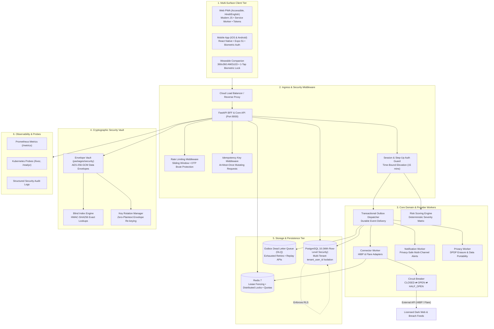
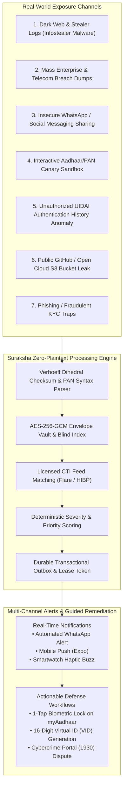

# Identity Protection Platform (Aadhaar & Identity Tracker)

[](https://www.python.org/downloads/)
[](https://fastapi.tiangolo.com/)
[](tests/)
[](LICENSE)
[](docs/threat-model.md)

Production-grade, consent-first identity protection platform with verified email exposure monitoring, breach intelligence, licensed dark-web monitoring capabilities, actionable alerts, and India-specific Aadhaar/PAN protective assistance.

---

## Key Principles & Guardrails

1. **Consent-First & Verified Identifiers**: No external intelligence provider is ever queried for an unverified or unauthorized identifier.
2. **PostgreSQL RLS Defense-in-Depth**: Multi-tenant isolation enforced at application level and database row-level security.
3. **Strict Credential & PII Minimization**: Never stores plaintext passwords, session cookies, auth tokens, raw biometrics, or Aadhaar OTPs. Never scrapes government portals.
4. **India-Specific Protection Guidance**: Official Aadhaar/PAN protective workflows (UIDAI biometric lock guide, virtual ID generation, official auth history checking, user-reported concerns) with clear distinctions between official guidance and verified provider feeds.
5. **Transactional Outbox & Idempotent Asynchronous Processing**: Background workers communicate via a durable transactional outbox and strict lease/fencing tokens.

---

## Repository Structure

```
.
├── AGENTS.md                  # Project rules & non-negotiable invariants
├── docs/                      # PRD, Architecture, Threat Model, Policies & Runbooks
│   ├── daily-notes/           # Daily progress logs & interaction notes (e.g. 2026-11-09)
│   ├── cases/                 # Comprehensive data flow specs (case-01 to case-07)
│   ├── minisky-local-cloud.md # Local GCP cloud emulation & hosting guide
│   ├── prd.md
│   ├── architecture.md
│   ├── threat-model.md
│   ├── data-classification.md
│   ├── retention-policy.md
│   ├── provider-capabilities.md
│   ├── test-plan.md
│   ├── traceability.md
│   ├── decisions/             # Architecture Decision Records (ADR-001 to ADR-015)
│   └── runbooks/              # Operational runbooks (outage, key rotation, deletion, etc.)
├── contracts/                 # OpenAPI specification and Event Schemas
│   ├── openapi.yaml
│   ├── events/
│   └── provider-fixtures/
├── packages/                  # Reusable domain, adapters, security, and redaction logic
│   ├── domain/                # Entities, states, scoring, and normalization models
│   ├── provider_adapters/     # HIBP & Flare connectors with capability registries
│   ├── security/              # Cryptographic envelope vault, blind indexing, and sessions
│   ├── redaction/             # Masking and PII sanitization filters
│   └── observability/         # Audit events, metrics, and structured logging
├── services/                  # Micro-modular services and background workers
│   ├── api/                   # FastAPI Business API + BFF session endpoints
│   ├── connector_worker/      # Scheduled & on-demand provider scanning worker
│   ├── notification_worker/   # Privacy-safe alert dispatcher
│   └── privacy_worker/        # Account deletion & data export lifecycle worker
├── apps/
│   ├── web/                   # Responsive web app + PWA with accessible UI & Hindi i18n
│   ├── mobile/                # React Native / Expo cross-platform mobile app (iOS & Android)
│   └── wearable/              # Smartwatch companion client (Wear OS Tile & watchOS Glance)
├── dummy_data_to_test/        # Synthetic test data generators, DB seeder & JSON fixtures
│   ├── generator.py           # Core Verhoeff Aadhaar, PAN, and profile generator
│   ├── seed_db.py             # Database seeder & fixture exporter
│   ├── synthetic_bundle.json  # Complete exported test fixture bundle
│   └── README.md              # Documentation for dummy data generation
├── minisky_fork/              # Local GCP emulator (Cloud Run, Secret Manager, GCS)
│   ├── minisky                # Pre-built binary executable (:8080 Gateway & :8081 Web Console)
│   ├── docs/                  # MiniSky service emulation specifications
│   └── ui/                    # React Web Console dashboard source
├── tests/                     # Unit, property, integration, contract, security, and E2E tests
└── infrastructure/            # Docker compose & configuration
```

---

## Client Applications

The platform provides unified multi-surface clients connected to the core engine:

| Client Surface | Technology Stack | Features | Access / Run Command |
| :--- | :--- | :--- | :--- |
| **Web Client** | Modern Vanilla JS + PWA Service Worker + CSS Tokens | 10 PRD views, English/Hindi i18n, offline caching, accessible high-contrast navigation | Served at `http://localhost:8000/` |
| **Mobile Client** | React Native 0.74 + Expo 51 + TypeScript | Bottom tab navigation, Face ID/Fingerprint app lock, step-up elevation, scan trigger, dispute modal | `cd apps/mobile && npx expo start` |
| **Wearable Client** | Smartwatch 360x360 AMOLED UI + Haptic Feedback | 1-second Shield Glance dial, urgent breach card with haptic buzz, 1-tap "Lock Biometrics" quick action, AOD ambient mode | Served at `http://localhost:8000/wearable` |

---

## Quickstart

### Prerequisites
- Python 3.11+
- `uv` package manager (`curl -LsSf https://astral.sh/uv/install.sh | sh`)
- Node.js 18+ (tested on Node v24.15)

### Setup & Installation
```bash
# Clone and enter the repository (with submodules for MiniSky)
git clone --recurse-submodules git@github.com:ghprud238/aadhar-tracker.git
cd aadhar-tracker

# If already cloned, initialize the minisky_fork submodule:
git submodule update --init --recursive

# Install virtualenv and all dependencies
uv sync

# Run the test suite (54 tests passing 100%)
uv run pytest -v

# Run the high-concurrency async load benchmark (400+ RPS)
PYTHONPATH=. uv run python tests/load/run_benchmark.py
```

## 🌐 Running the Web Version Locally (Step-by-Step)

The Web Client is a modern, responsive **Progressive Web App (PWA)** hosted directly by the FastAPI backend at `http://localhost:8000/`.

### 1. Open Terminal & Navigate to the Project
```bash
cd /Users/dpcubed/projects/aadhar-tracker
```

### 2. Ensure Dependencies Are Installed
```bash
uv sync
```

### 3. Start the Server
```bash
uv run python main.py
# or
uv run uvicorn services.api.main:app --host 0.0.0.0 --port 8000 --reload
```
*Expected terminal output:*
```
INFO:     Started server process [85123]
INFO:     Waiting for application startup.
INFO:     Application startup complete.
INFO:     Uvicorn running on http://0.0.0.0:8000 (Press CTRL+C to quit)
```

### 4. Open in Your Browser
Open your browser and navigate to:  
👉 **[http://localhost:8000/](http://localhost:8000/)** (or `/app`)

### 5. What You Can See & Test
* **Automatic Session Bootstrap:** Initializes a demo resident profile (`resident@example.in` / `Aarav Sharma`) and displays masked telemetry.
* **10 Dedicated PRD Views:**
  1. **📊 Overview:** Live shield status indicator (Secure / Warning / Critical) and quick scan trigger.
  2. **🔑 Identities:** Add an email, receive a 6-digit verification challenge token, verify ownership, pause, or remove.
  3. **⚠️ Incidents:** Review simulated breaches from HIBP and Flare, inspect exposed data classes (passwords, PII), complete remediation checklists, or log false-positive disputes.
  4. **✅ Protection Actions:** Active and completed remediation task trackers.
  5. **🇮🇳 Aadhaar & PAN Assistance:** Interactive offline-ready Aadhaar Biometric Lock guide (direct links to official UIDAI `myaadhaar.uidai.gov.in` & mAadhaar), PAN-Aadhaar linkage check, and fraud reporting form.
  6. **🌐 Coverage Transparency:** Full breakdown of monitored sources vs. non-monitored government portals, with clear zero-scraping guarantees.
  7. **🔔 Notifications:** Alerts and digest preferences.
  8. **💳 Billing & Plans:** Tiered subscription management (Basic / Pro) with server-side Razorpay amount enforcement.
  9. **🔒 Privacy Center:** Generate a machine-readable JSON data export and submit DPDP Act account erasure requests.
  10. **🛡️ Account Security:** Step-up authentication elevation (use password `SecretMaster123!`).
* **Bilingual Switcher:** Toggle between **English** and **हिंदी (Hindi)** in the bottom-left sidebar.
* **PWA Installable:** In Chrome, Edge, or Brave, click the **Install** icon in the URL bar to test the offline-capable standalone PWA experience.

### 6. Complementary Local Endpoints
While the server is running on port 8000:
* **Smartwatch Companion (Wearable Simulator):** [http://localhost:8000/wearable](http://localhost:8000/wearable) (360x360 circular AMOLED display, haptic buzz, 1-tap Biometric Lock confirmation).
* **Interactive API Documentation:** [http://localhost:8000/docs](http://localhost:8000/docs) (Swagger UI).
* **Prometheus Metrics:** [http://localhost:8000/metrics](http://localhost:8000/metrics)
* **Kubernetes Probes:** [http://localhost:8000/readyz](http://localhost:8000/readyz) and [http://localhost:8000/livez](http://localhost:8000/livez)

### 7. Stopping the Server
Press `Ctrl + C` in the terminal to stop the local server.

---

## System Architecture

Suraksha Platform is architected as an asynchronous, event-driven, multi-tenant identity protection engine with strict defense-in-depth security, non-bypassable database row-level security (RLS), and zero-plaintext credential invariants.

### Architecture Diagram



### Architectural Components

| Component | Path | Responsibility |
| :--- | :--- | :--- |
| **BFF & API Gateway** | [`services/api/`](file:///Users/dpcubed/projects/aadhar-tracker/services/api/) | Manages client sessions, REST endpoints, OpenAPI v3 contracts, rate limits, and idempotency guarantees. |
| **Cryptographic Vault** | [`packages/security/`](file:///Users/dpcubed/projects/aadhar-tracker/packages/security/) | AES-256-GCM envelope encryption and blind indexing. Prevents plaintext storage of sensitive identifiers. |
| **Provider Adapters & Circuit Breaker** | [`packages/provider_adapters/`](file:///Users/dpcubed/projects/aadhar-tracker/packages/provider_adapters/) | External integration with HaveIBeenPwned and Flare dark web feeds protected by fail-fast circuit breakers. |
| **Transactional Outbox & DLQ** | [`services/api/outbox_dispatcher.py`](file:///Users/dpcubed/projects/aadhar-tracker/services/api/outbox_dispatcher.py) | Guaranteed at-least-once message delivery. Unrecoverable failures move to Dead Letter Queue for operator replay. |
| **Connector Worker** | [`services/connector_worker/`](file:///Users/dpcubed/projects/aadhar-tracker/services/connector_worker/) | Asynchronous scheduled and on-demand scan processing with lease fencing tokens. |
| **Notification Worker** | [`services/notification_worker/`](file:///Users/dpcubed/projects/aadhar-tracker/services/notification_worker/) | Privacy-safe alerting that strips credentials before sending emails or webhooks. |
| **Privacy Worker** | [`services/privacy_worker/`](file:///Users/dpcubed/projects/aadhar-tracker/services/privacy_worker/) | Enforces Indian DPDP Act right-to-erasure and machine-readable data portability export. |
| **Risk Scoring Engine** | [`packages/domain/scoring.py`](file:///Users/dpcubed/projects/aadhar-tracker/packages/domain/scoring.py) | Deterministic severity scoring (Critical, High, Medium, Low) based on exposed data classes and credential sensitivity. |
| **Verhoeff & Identity DLP Engine** | [`packages/domain/verhoeff.py`](file:///Users/dpcubed/projects/aadhar-tracker/packages/domain/verhoeff.py) | Mathematical Verhoeff dihedral D5 checksum validation for Aadhaar, PAN regex validation, and message text DLP scanning. |
| **WhatsApp DLP & Webhook Gateway** | [`services/api/routes/whatsapp.py`](file:///Users/dpcubed/projects/aadhar-tracker/services/api/routes/whatsapp.py) | Inbound Meta Cloud API webhook processor and real-time automated WhatsApp security advisory dispatcher. |

---

## 🔍 End-to-End Tracking Use Cases & Data Flows (User ➔ Backend ➔ User)

The platform handles identity exposures across seven distinct architectural flows, ensuring that sensitive credentials never touch the database in plaintext, that users are notified within seconds, and that actionable legal guidance is provided.



---

### Detailed Architectural Flows

#### 1. Insecure WhatsApp / Social Messaging Transmission (DLP & Real-Time Alert)
* **Problem:** Residents frequently forward unmasked photocopies or text of their 12-digit Aadhaar or PAN on WhatsApp for hotel check-ins, job applications, or flight bookings, where it is permanently indexed in cloud backups and exposed to spyware.
* **End-to-End Flow:**
  ```mermaid
  sequenceDiagram
      autonumber
      actor User as Resident / Sender
      participant WA as WhatsApp App / Webhook
      participant API as Suraksha API (/whatsapp/simulate-share)
      participant DLP as Verhoeff & DLP Engine
      participant Vault as AES-256-GCM Vault
      participant Outbox as Transactional Outbox
      participant DB as PostgreSQL (RLS)
      actor Recipient as WhatsApp User

      User->>WA: Sends message: "My Aadhaar is 9999 4105 7058 for checkin"
      WA->>API: Inbound Webhook / Mobile Share Intent payload
      API->>DLP: detect_identifiers_in_text(message_text)
      DLP->>DLP: Validates 12-digit Verhoeff Dihedral Checksum
      DLP-->>API: Match Confirmed: Aadhaar XXXX-XXXX-7058
      API->>Vault: Encrypt identifier & compute HMAC-SHA256 blind index
      API->>DB: Insert Incident (Severity: High, State: New)
      API->>Outbox: Enqueue OutboxEvent (event_type: incident.detected)
      API->>WA: Dispatches Automated WhatsApp Security Advisory
      WA-->>User: ⚠️ "SURAKSHA ALERT: Unmasked Aadhaar detected! Delete for everyone immediately and lock biometrics."
      User->>DB: Confirms Biometric Lock via Suraksha Dashboard
  ```
* **Backend Handling:**
  - `packages/domain/verhoeff.py` parses arbitrary message text and validates the check digit via Dihedral Group $D_5$ permutations.
  - Automatically creates an in-app Incident, logs an immutable Audit Event, and sends a formatted WhatsApp security alert to the sender advising them to "Delete for Everyone" and switch to a 16-digit Virtual ID.

---

#### 2. Dark Web & Infostealer Malware Exfiltration
* **Problem:** A resident's PC or laptop is infected by infostealer malware (Lumma, RedLine, Vidar) distributed through malicious email attachments. The malware harvests saved passwords, browser autofill records, session cookies, and local identity PDFs (e-Aadhaar scans).
* **End-to-End Flow:**
  1. Malware compiles stolen records into a ZIP archive and uploads it to an underground Telegram channel or Tor forum.
  2. Licensed threat intelligence provider (**Flare Systems**) indexes the stealer log.
  3. Connector Worker (`services/connector_worker/`) executes scheduled queries using the verified resident's blind index.
  4. Flare reports a match indicating `exposure_type: stealer_log` and `contains_credentials: true`.
  5. The redaction engine (`packages/redaction/masking.py`) strips any raw passwords or cookies, recording only the exposure class.
  6. The Scoring Engine assigns a **Critical (Score 95)** priority rating.
  7. Outbox Dispatcher fires real-time mobile push notifications and smartwatch haptic alerts.
  8. User checklist: Run malware scanner, terminate active web sessions, and enable UIDAI Biometric Lock.

---

#### 3. Mass Enterprise / Telecom KYC Database Dump
* **Problem:** An Indian telecom service provider, payment gateway, or insurance firm suffers an unauthenticated database dump exposing millions of KYC records containing names, emails, phone numbers, PAN cards, and Aadhaar numbers.
* **End-to-End Flow:**
  1. Threat actor leaks the database on a dark-web leak forum.
  2. Provider (**HaveIBeenPwned** / **Flare**) ingests the breach metadata and catalogues compromised data classes (`["Email addresses", "Phone numbers", "Aadhaar numbers", "PAN"]`).
  3. Platform correlates the breach with the resident's verified email.
  4. Backend creates an Incident and groups related observations under a deterministic grouping key (`grouping_key = provider:breach_name`).
  5. User is alerted with an explanation of which third party was breached and what data classes were exposed.
  6. Remediation workflow guides the resident to check their **Annual Information Statement (AIS)** on the Income Tax portal and review **CIBIL credit files** for fraudulent loan accounts opened in their name.

---

#### 4. Interactive Canary Sandbox Testing (Testing with Real Aadhaar & PAN Numbers)
* **Goal:** Allow security engineers, auditors, and developers to test the live end-to-end detection, encryption, and alert pipeline using official test Aadhaar and PAN numbers without violating privacy laws.
* **Available Test Sandbox Presets:**
  | Preset ID | Type | Test Number | Masked View | Verhoeff Checksum | Simulated Scenario |
  | :--- | :--- | :--- | :--- | :--- | :--- |
  | `aadhaar_sandbox_1` | Aadhaar | `9999 4105 7058` | `XXXX-XXXX-7058` | **VALID (c = 0)** | Dark Web Underground Market (Score 95) |
  | `aadhaar_sandbox_2` | Aadhaar | `9999 0000 0016` | `XXXX-XXXX-0016` | **VALID (c = 0)** | Telecom KYC Database Breach (Score 85) |
  | `aadhaar_sandbox_3` | Aadhaar | `2345 6789 0124` | `XXXX-XXXX-0124` | **VALID (c = 0)** | Insecure WhatsApp Group Forward (Score 88) |
  | `aadhaar_sandbox_4` | Aadhaar | `5432 1098 7652` | `XXXX-XXXX-7652` | **VALID (c = 0)** | Infostealer Malware Exfiltration (Score 92) |
  | `pan_sandbox_1` | PAN | `ABCDE1234F` | `AB***12*F` | **VALID (IT Format)** | Financial Banking Breach (Score 85) |
  | `pan_sandbox_2` | PAN | `XYZPK9876M` | `XY***98*M` | **VALID (IT Format)** | Credit Card Dump (Score 80) |

* **How to Test in the Web UI:**
  1. Open the Web App: 👉 **[http://localhost:8000/app#assistance](http://localhost:8000/app#assistance)**
  2. Scroll down to **"🧪 Aadhaar & PAN Exposure Sandbox"**.
  3. Select any preset (or type a custom 12-digit number) and select a threat scenario.
  4. Click **"🚀 Execute Live Exposure Test"**.
  5. Observe the live 6-stage pipeline trace (`Validation` ➔ `Envelope Encryption` ➔ `Blind Index` ➔ `CTI Synthesis` ➔ `Outbox Queue` ➔ `Incident Created`).
  6. Click **"View Incident in Dashboard"** to see the newly generated incident with its remediation checklist.

* **How to Test via Terminal (cURL):**
  ```bash
  # 1. Obtain a demo session token
  TOKEN=$(curl -s "http://localhost:8000/api/v1/auth/callback?email=tester@example.in&full_name=Test+User" | grep -o '"session_id":"[^"]*' | cut -d'"' -f4)

  # 2. Execute Canary Test with UIDAI Sandbox Aadhaar
  curl -X POST "http://localhost:8000/api/v1/identity-assistance/canary-test" \
    -H "Authorization: Bearer $TOKEN" \
    -H "Content-Type: application/json" \
    -d '{
      "preset_id": "aadhaar_sandbox_1",
      "leak_scenario": "darkweb_market"
    }'
  ```

* **How to Test the WhatsApp DLP Scanner via Terminal (cURL):**
  ```bash
  curl -X POST "http://localhost:8000/api/v1/integrations/whatsapp/simulate-share" \
    -H "Authorization: Bearer $TOKEN" \
    -H "Content-Type: application/json" \
    -d '{
      "message_text": "Hi, please find my Aadhaar 9999 4105 7058 for room checkin.",
      "sender_phone": "+919876543210",
      "channel": "whatsapp_direct"
    }'
  ```

---

#### 5. Unauthorized UIDAI Authentication History Anomaly
* **Problem:** A resident checks their UIDAI auth log and spots an unauthorized OTP or biometric auth event from an unfamiliar Requesting Entity (AUA) or telecom circle.
* **End-to-End Flow:**
  1. Resident reviews the official 50-event authentication history following our in-app guide (`/identity-assistance/guides`).
  2. Resident files a structured incident via `POST /identity-assistance/reports` selecting `"suspicious_auth_history"`.
  3. The platform sanitizes and redacts all free-text fields (`packages/redaction/sanitizer.py`).
  4. The platform generates an immediate official dispute dossier:
     - Direct escalation to UIDAI Grievance Helpline (**1947** / `help@uidai.gov.in`).
     - Prefilled cybercrime complaint format for the **National Cyber Crime Reporting Portal** (`cybercrime.gov.in` / **1930**).

---

#### 6. Public GitHub / Open Cloud S3 Bucket Leak
* **Problem:** A developer or merchant accidentally commits a `.csv` file, `.env` file, or client KYC folder containing unmasked customer Aadhaar and PAN numbers to a public GitHub repository or unauthenticated Amazon S3 bucket.
* **End-to-End Flow:**
  1. Secret scanning engines detect sensitive regex patterns (`[2-9]{1}[0-9]{3}\\s[0-9]{4}\\s[0-9]{4}`).
  2. Platform receives public repository webhook or Flare external intelligence alert.
  3. Platform matches the resident's blind index.
  4. Immediate alert dispatches with recommended steps:
     - Issue immediate git history purge (`git-filter-repo` / BFG Repo-Cleaner).
     - Invalidate any API tokens committed alongside the file.
     - Advise impacted residents to activate UIDAI biometric lock.

---

#### 7. Phishing & Vishing Trap (Fake KYC Update Calls)
* **Problem:** Fraudsters call residents claiming to be from the State Bank of India (SBI) or the Income Tax Department, threatening account freezing unless the resident shares an incoming Aadhaar OTP.
* **End-to-End Flow:**
  1. Resident receives suspicious SMS or call.
  2. Resident opens the **Suraksha Web or Mobile App** and checks **Coverage Transparency**.
  3. Platform prominently reinforces: *"UIDAI and Income Tax officials NEVER call citizens demanding OTPs over the phone."*
  4. Resident logs the scam call in the **Assistance Center**.
  5. Platform reinforces that having biometric lock enabled renders OTP theft ineffective for physical identity impersonation.

---

## 🧪 Synthetic Test Data & Fixture Generation (`dummy_data_to_test`)

To ensure thorough, reproducible testing and developer onboarding without exposing real citizen PII, all synthetic generators, seeders, and exported fixtures are housed in the dedicated [`dummy_data_to_test/`](dummy_data_to_test/) directory:

- **Core Generator:** [`dummy_data_to_test/generator.py`](dummy_data_to_test/generator.py) (re-exported via [`packages/domain/synthetic.py`](packages/domain/synthetic.py))
- **Database Seeder & Fixture Exporter:** [`dummy_data_to_test/seed_db.py`](dummy_data_to_test/seed_db.py)
- **Directory Guide:** [`dummy_data_to_test/README.md`](dummy_data_to_test/README.md)

### 1. Generated Data Assets
- **Mathematically Valid Aadhaar Numbers**: 12 digits calculated using the official **Verhoeff Dihedral $D_5$ algorithm** with developer test prefix `9999...` to prevent collision with real resident identifiers.
- **Valid PAN Identifiers**: 10 characters conforming to Income Tax syntax (`[A-Z]{3}P[SurnameInitial][0-9]{4}[A-Z]`).
- **Complete Indian Resident Profiles**: Full synthetic records (First Name, Last Name, Email, Phone, Aadhaar, PAN, VID, Address across 12 Indian states).
- **Simulated Dark Web Breach Dumps**: Multi-record mock dumps for Telecom KYC leaks, Fintech applicant breaches, Lumma Stealer botnet archives, and hospital diagnostic records.
- **WhatsApp DLP Sample Threads**: English and Hinglish multi-turn chat threads containing unmasked IDs to test DLP interception.

### 2. Run Directly from `dummy_data_to_test`
```bash
# 1. Print a sample synthetic citizen profile to terminal
python dummy_data_to_test/generator.py

# 2. Export / Refresh JSON fixtures
python dummy_data_to_test/seed_db.py --export-fixtures

# 3. Seed local database with 10 synthetic residents, encrypted identifiers & incidents
python dummy_data_to_test/seed_db.py --seed-db --residents 10
```

*Generated Files in [`dummy_data_to_test/`](dummy_data_to_test/) and [`tests/fixtures/`](tests/fixtures/):*
- `synthetic_identities.json`: 50 valid synthetic Indian citizen profiles
- `synthetic_breach_catalog.json`: Simulated dark web database dumps with magnet hashes
- `synthetic_whatsapp_messages.json`: Realistic chat conversations for DLP verification
- `synthetic_bundle.json`: Unified fixture dataset for automated testing

### 3. On-Demand Synthetic API Endpoint
```bash
# Fetch on-demand synthetic test identities and breach scenarios via API
TOKEN=$(curl -s "http://localhost:8000/api/v1/auth/callback?email=citizen@suraksha.in&full_name=Aarav+Sharma" | python3 -c 'import sys, json; print(json.load(sys.stdin)["data"]["session_id"])')

curl -s -H "Authorization: Bearer $TOKEN" "http://localhost:8000/api/v1/identity-assistance/synthetic-dataset?count=5&include_breaches=true" | python3 -m json.tool
```

---

## ☁️ Universal Cloud Docker Deployment Guide

The container is built with a production-grade **multi-stage Docker build** that strips compiler dependencies, runs as an unprivileged user (`appuser` UID 10001), honors dynamic `$PORT` environments, and includes built-in Kubernetes/cloud health checks (`/livez`).

### 1. Build Container Image Locally
```bash
docker build -t aadhar-tracker:latest .
```

### 2. Run Container Locally
```bash
docker run -d \
  -p 8000:8000 \
  -e PORT=8000 \
  -e WORKERS=2 \
  -e ENVIRONMENT=production \
  --name suraksha-api \
  aadhar-tracker:latest
```
Verify the container health:
```bash
curl -f http://localhost:8000/livez
# {"status":"ok","timestamp":"..."}
```

---

### 3. Deploy to Major Cloud Platforms

#### A. Google Cloud Run (Fully Managed Serverless Container)
Cloud Run automatically injects `$PORT` and scales from zero.
```bash
# 1. Authenticate & Configure Project
gcloud auth login
gcloud config set project YOUR_GCP_PROJECT_ID

# 2. Build and Submit Image to Google Artifact Registry
gcloud builds submit --tag gcr.io/YOUR_GCP_PROJECT_ID/aadhar-tracker:latest .

# 3. Deploy to Cloud Run
gcloud run deploy aadhar-tracker \
  --image gcr.io/YOUR_GCP_PROJECT_ID/aadhar-tracker:latest \
  --platform managed \
  --region asia-south1 \
  --allow-unauthenticated \
  --set-env-vars ENVIRONMENT=production,DATABASE_URL="postgresql://user:pass@/dbname?host=/cloudsql/INSTANCE_CONNECTION_NAME" \
  --cpu 1 \
  --memory 1Gi \
  --min-instances 1 \
  --max-instances 10
```

#### B. AWS App Runner & Amazon ECS (Fargate)
AWS App Runner offers zero-ops container deployments connected to AWS ECR.
```bash
# 1. Login to Amazon ECR
aws ecr get-login-password --region ap-south-1 | docker login --username AWS --password-stdin YOUR_ACCOUNT_ID.dkr.ecr.ap-south-1.amazonaws.com

# 2. Tag and Push Image
docker tag aadhar-tracker:latest YOUR_ACCOUNT_ID.dkr.ecr.ap-south-1.amazonaws.com/aadhar-tracker:latest
docker push YOUR_ACCOUNT_ID.dkr.ecr.ap-south-1.amazonaws.com/aadhar-tracker:latest

# 3. Create App Runner Service (or use AWS ECS Fargate Task Definition)
aws apprunner create-service \
  --service-name aadhar-tracker-service \
  --source-configuration '{
    "ImageRepository": {
      "ImageIdentifier": "YOUR_ACCOUNT_ID.dkr.ecr.ap-south-1.amazonaws.com/aadhar-tracker:latest",
      "ImageConfiguration": { "Port": "8000" },
      "ImageRepositoryType": "ECR"
    },
    "AutoDeploymentsEnabled": true
  }'
```

#### C. Azure Container Apps
```bash
# 1. Create Azure Resource Group & Container Environment
az group create --name SurakshaGroup --location centralindia
az containerapp env create --name SurakshaEnv --resource-group SurakshaGroup --location centralindia

# 2. Build and Deploy Container App
az containerapp up \
  --name aadhar-tracker \
  --resource-group SurakshaGroup \
  --environment SurakshaEnv \
  --source . \
  --target-port 8000 \
  --ingress external
```

#### D. Fly.io / Render / DigitalOcean App Platform
Because the image respects dynamic `$PORT` and provides `/livez` health probes, simply deploy directly:
- **Fly.io:**
  ```bash
  fly launch
  fly deploy
  ```
- **Render:** Connect GitHub repository, select **Docker Runtime**, and Render will automatically detect the `Dockerfile` and inject `$PORT`.

#### E. On-Premise / Virtual Machine (Full Docker Compose Stack)
To run the full production ecosystem (PostgreSQL with RLS, Redis 7, API Workers, Outbox Dispatcher, Prometheus, and Grafana):
```bash
cd infrastructure
docker compose -f docker-compose.prod.yml up -d
```
Inspect stack status:
```bash
docker compose -f docker-compose.prod.yml ps
```

#### F. Local Cloud Hosting & Emulation (Testing Locally with MiniSky)

You can mimic full Google Cloud Platform (GCP) serverless deployment, Secret Manager, and Cloud Storage on your local laptop without incurring cloud billing or requiring cloud IAM credentials using **MiniSky**, conveniently bundled directly in [`minisky_fork/`](minisky_fork/). For the full operational runbook, see [docs/minisky-local-cloud.md](docs/minisky-local-cloud.md).

```
┌────────────────────────────────────────────────────────────────────────┐
│                        Local Laptop Environment                        │
│                                                                        │
│   MiniSky API Gateway (:8080) & Emulator Dashboard (:8081)             │
│   ├── run.googleapis.com ────────────► Docker Engine (Serverless VM)    │
│   │                                    └── minisky-serverless-aadhar-  │
│   │                                        tracker (:55003 -> :8000)   │
│   ├── secretmanager.googleapis.com ──► In-memory / Mock KMS Secrets    │
│   │                                    └── APP_MASTER_ENCRYPTION_KEY   │
│   └── storage.googleapis.com ────────► Fake-GCS Server (:4443)         │
│                                        └── gs://suraksha-audit-logs    │
└────────────────────────────────────────────────────────────────────────┘
```

1. **Start the Local MiniSky Emulator:**
   Launch the daemon directly from the root of the repository:
   ```bash
   ./minisky_fork/minisky start
   # Or navigate into the folder:
   # cd minisky_fork && ./minisky start
   ```
   *Expected Output:*
   ```text
   MiniSky Daemon started successfully.
   API Gateway: http://localhost:8080
   Dashboard:   http://localhost:8081
   ```

2. **Verify That MiniSky is Running:**
   - **Visual Control Console:** Open [http://localhost:8081](http://localhost:8081) in your browser.
   - **Terminal Port Check:** Run `lsof -i :8080 -i :8081` (confirm ports 8080 and 8081 are in `LISTEN` state).
   - **CLI Resource Inspection:**
     ```bash
     ./minisky_fork/minisky list
     ```

3. **Deploy Suraksha Platform as a Cloud Run Service:**
   First, build the production container image:
   ```bash
   docker build -t aadhar-tracker:latest -f infrastructure/Dockerfile.prod .
   ```
   Deploy to the emulated Cloud Run API Gateway:
   ```bash
   curl -X POST "http://localhost:8080/v2/projects/local-dev-project/locations/asia-south1/services?serviceId=aadhar-tracker" \
     -H "Content-Type: application/json" \
     -d '{
       "template": {
         "containers": [{
           "image": "aadhar-tracker:latest",
           "ports": [{"containerPort": 8000}],
           "env": [
             {"name": "PORT", "value": "8000"},
             {"name": "WORKERS", "value": "2"},
             {"name": "ENVIRONMENT", "value": "production"},
             {"name": "DATABASE_URL", "value": "sqlite+aiosqlite:////app/data/suraksha.db"},
             {"name": "SESSION_DB_PATH", "value": "/app/data/sessions.db"}
           ]
         }]
       }
     }'
   ```
   MiniSky provisions a live container `minisky-serverless-aadhar-tracker` and routes traffic from a dynamic port (e.g., `http://127.0.0.1:55003`).

4. **Verify Container Health & Probes:**
   ```bash
   curl -i http://127.0.0.1:55003/livez
   # Returns HTTP 200 OK {"status":"alive"} with CSP, HSTS, and X-Frame-Options
   ```

5. **Emulate Google Secret Manager:**
   ```bash
   # Create secret
   curl -X POST "http://localhost:8080/v1/projects/local-dev-project/secrets?secretId=APP_MASTER_ENCRYPTION_KEY" \
     -H "Content-Type: application/json" -d '{"replication":{"automatic":{}}}'

   # Add 256-bit AES master key version
   curl -X POST "http://localhost:8080/v1/projects/local-dev-project/secrets/APP_MASTER_ENCRYPTION_KEY:addVersion" \
     -H "Content-Type: application/json" -d '{"payload":{"data":"MDEyMzQ1Njc4OWFiY2RlZjAxMjM0NTY3ODlhYmNkZWY="}}'

   # Read secret version
   curl -s "http://localhost:8080/v1/projects/local-dev-project/secrets/APP_MASTER_ENCRYPTION_KEY/versions/latest:access"
   ```

6. **Emulate Google Cloud Storage (Audit Logs):**
   ```bash
   # Create bucket
   curl -X POST "http://localhost:8080/storage/v1/b?project=local-dev-project" \
     -H "Content-Type: application/json" -d '{"name":"suraksha-audit-logs","location":"asia-south1"}'

   # Upload audit export blob
   curl -X POST "http://localhost:8080/upload/storage/v1/b/suraksha-audit-logs/o?uploadType=media&name=audit-sample.json" \
     -H "Content-Type: application/json" -d '{"event":"audit_test","status":"verified"}'
   ```

7. **Execute Canary Sandbox & WhatsApp DLP against Cloud Run Container:**
   ```bash
   PORT=55003
   # 1. Login citizen
   TOKEN=$(curl -s "http://127.0.0.1:$PORT/api/v1/auth/callback?email=citizen@suraksha.in&full_name=Aarav+Sharma" | python3 -c 'import sys, json; print(json.load(sys.stdin)["data"]["session_id"])')

   # 2. Trigger Canary Exposure Test (UIDAI Sandbox Dummy #1)
   curl -X POST "http://127.0.0.1:$PORT/api/v1/identity-assistance/canary-test" \
     -H "Authorization: Bearer $TOKEN" \
     -H "Content-Type: application/json" \
     -d '{"preset_id":"aadhaar_sandbox_1"}'

   # 3. Simulate Insecure WhatsApp Aadhaar/PAN Forward
   curl -X POST "http://127.0.0.1:$PORT/api/v1/integrations/whatsapp/simulate-share" \
     -H "Authorization: Bearer $TOKEN" \
     -H "Content-Type: application/json" \
     -d '{"message_text":"My Aadhaar is 9999 4105 7058 and PAN is ABCDE1234F","sender_phone":"+919876543210"}'
   ```

8. **Stopping the MiniSky Daemon:**
   When testing is complete, stop the background daemon:
   ```bash
   ./minisky_fork/minisky stop
   ```

---

## Environment Variables Reference

| Variable | Default | Description |
| :--- | :--- | :--- |
| `PORT` | `8000` | HTTP port for Uvicorn server (automatically set on Cloud Run/App Runner/Render) |
| `WORKERS` | `2` | Number of Uvicorn worker processes |
| `ENVIRONMENT` | `production` | Environment profile (`development`, `staging`, `production`) |
| `DATABASE_URL` | `sqlite:///:memory:` | PostgreSQL or SQLite database connection URI (must support RLS in production) |
| `REDIS_URL` | `redis://localhost:6379/0` | Redis instance for rate limiting, locking, and outbox leasing |
| `RUN_MIGRATIONS` | `false` | When set to `true` or `1`, automatically runs `alembic upgrade head` on container boot |
| `MASTER_ENCRYPTION_KEY` | *(auto-generated)* | 32-byte hex/base64 key for AES-256-GCM envelope vault encryption |
| `JWT_SECRET_KEY` | *(auto-generated)* | Secret for signing session cookies and step-up auth elevation tokens |
| `HIBP_API_KEY` | `""` | Optional API key for live HaveIBeenPwned enterprise feed (mock mode used if empty) |
| `FLARE_API_KEY` | `""` | Optional API key for Flare Dark Web intelligence (mock mode used if empty) |

---

## Enterprise Robustness Architecture

The platform includes production-grade resilience and reliability capabilities:

1. **⚡ Circuit Breakers (`packages/provider_adapters/circuit_breaker.py`):** Protects against cascading third-party provider failures (HIBP, Flare) with `CLOSED` → `OPEN` → `HALF_OPEN` state transitions and configurable failure thresholds.
2. **📬 Outbox Dead Letter Queue (DLQ):** Failed background outbox events transition to `dead_letter` after 3 exhausted attempts, preserving error traces, execution context, and supporting operator replay via `/api/v1/internal/dead-letters/{id}/replay`.
3. **🔁 Idempotency Key Middleware (`services/api/middleware/idempotency.py`):** Guarantees at-most-once execution for mutating requests with `Idempotency-Key` headers, replaying cached responses on network retries.
4. **🛡️ Sliding Window Rate Limiting (`services/api/middleware/rate_limit.py`):** Prevents OTP verification brute-force attacks (5 attempts / 15 mins) and protects scan quotas without storing PII.
5. **📊 Prometheus Observability & Probes (`services/api/routes/health.py`):** Native Prometheus metrics exporter (`/metrics`) and Kubernetes `/livez` & `/readyz` probes validating DB connection pools and circuit health.
6. **🔐 Cryptographic Key Rotation Manager (`packages/security/key_rotation.py`):** Re-encrypts resident data envelopes under a new Master Key without exposing plaintext credentials to persistent storage.
7. **🗄️ Database Migrations (Alembic):** Versioned schema migrations configured via `alembic upgrade head` for zero-downtime database upgrades.
8. **🐳 Production Docker Compose (`infrastructure/docker-compose.prod.yml`):** Production stack with PostgreSQL 16 (RLS), Redis 7, API workers, Prometheus, and Grafana.

### Running the Mobile Client (Expo)
```bash
cd apps/mobile
npm install
npx expo start
```
From the Expo terminal, press `i` to open the iOS simulator, `a` for Android emulator, or `w` for Web.

