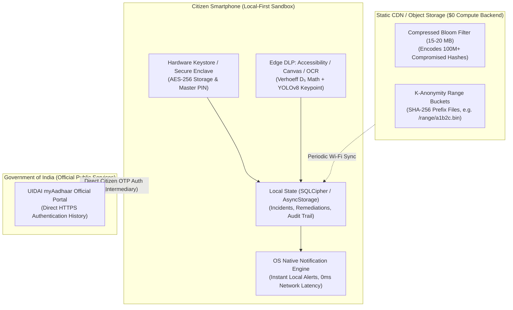

# Technical Architecture Specification

## 1. High-Level Architecture Overview

The system is constructed as a **modular monolith** for core API handling, paired with isolated background workers for tasks requiring privilege separation, specialized scaling, or asynchronous execution:

- **BFF / Web App**: Same-origin session cookies, PKCE OIDC login, secure HttpOnly tokens. Never exposes provider credentials or bearer tokens to browser local storage.
- **FastAPI Core Business API**: Scoped business operations, validation schemas, ownership enforcement, audit logging.
- **PostgreSQL Database with RLS**: Source of truth with Row-Level Security (`RLS`) enforcing tenant and subject boundary defense-in-depth. Transaction-local variables `app.current_tenant_id` and `app.current_subject_id`.
- **Transactional Outbox**: Business mutations and event intents persist in the same ACID transaction.
- **Connector Worker**: Scheduled and on-demand scanner executing against approved provider APIs (HIBP, Flare) with strict rate-limiting, blind-index lookups, and result normalization.
- **Notification Worker**: Dispatches privacy-safe email and in-app alerts with idempotency keys.
- **Privacy Worker**: Handles GDPR/DPDP export downloads, redactions, and multi-stage account deletions.

---

## 2. Component Boundaries and Privileges

| Component | Allowed Privileges | Forbidden Privileges |
| :--- | :--- | :--- |
| **Web / BFF** | Session operations, business API proxying | Intelligence provider API keys, DB direct access |
| **Business API** | Tenant-scoped CRUD, audit event recording | Raw provider secret keys, arbitrary evidence access |
| **Connector Worker** | Approved provider calls, scoped identifier decryption | Billing mutations, direct user session modification |
| **Notification Worker** | Template rendering, masked alert dispatch | Full raw provider payloads or decrypted credentials |
| **Privacy Worker** | Export assembly, cryptographic deletion sweeps | External internet scanning or provider querying |
| **Support Console** | Read-only metadata for user-approved tickets | Raw identifiers, leaked passwords, payment secrets |

---

## 3. Transactional Outbox & Queue Pattern

```
BEGIN TRANSACTION;
  INSERT/UPDATE business_table (e.g. incident, identifier);
  INSERT INTO outbox_events (event_id, event_type, tenant_id, subject_id, resource_id, payload);
COMMIT;
```

A resilient outbox dispatcher polls committed unhandled events, publishes them to the worker queue, and marks them processed. Workers maintain idempotency tables (`processed_events`) with leasing and fencing tokens.

---

## 4. Deployment & Cloud Emulation Architecture

The platform supports cloud-native serverless deployment (Google Cloud Run, AWS App Runner, Fly.io) as well as full on-premise container stacks:

- **Universal Multi-Stage Container**: Hardened non-root image (`python:3.11-slim`, UID 10001 `appuser`), dynamic `$PORT` binding, and `/livez` health probes.
- **Inter-Process Session Sharing**: Persistent SQLite session store (`user_sessions`) in [`packages/security/sessions.py`](file:///Users/dpcubed/projects/aadhar-tracker/packages/security/sessions.py) providing cross-worker state replication for multi-worker application servers.
- **Local GCP Emulation via MiniSky**: Complete local offline mimicking of Google Cloud Run (`run.googleapis.com`), Secret Manager (`secretmanager.googleapis.com`), and Cloud Storage (`storage.googleapis.com`) using MiniSky on ports `:8080` / `:8081`. Full operational runbook documented in [`docs/minisky-local-cloud.md`](file:///Users/dpcubed/projects/aadhar-tracker/docs/minisky-local-cloud.md).

---

## 5. Local-First / Zero-Backend Architecture (Client-Only Mode)

To strictly eliminate server-side liability under India's **Digital Personal Data Protection (DPDP) Act 2023**, the platform supports an autonomous, zero-backend operational mode where **no central compute server processes citizen identity data**:



### The Three Pillars of Serverless Tracking:
1. **Outbound Transmission Tracking (Edge DLP)**: Intercepts active typing, clipboard pasting, and media sharing across messaging apps (WhatsApp, Telegram, SMS) directly on device via pure Verhoeff $D_5$ matrix math ($<0.01$ms) and on-device OCR ($<30$ms).
2. **Inbound Breach & Dark Web Leak Tracking (Static K-Anonymity / Bloom Filters)**: Eliminates dynamic database servers by downloading a pre-compiled, static 15 MB Bloom filter or querying 5-character K-anonymity ranges over static CDN storage. The phone matches hashes locally without leaking identity queries to anyone.
3. **Live Authentication & Fraud Tracking (Direct Citizen-to-UIDAI)**: The mobile client connects directly to official government portals (`myaadhaar.uidai.gov.in`) using official citizen OTP login to audit recent biometric and OTP authentication transactions, completely bypassing any intermediary third-party server.

