# End-to-End Tracking Use Cases & Dataflow Catalog

**Suraksha Identity Protection Platform**  
**Repository:** `/Users/dpcubed/projects/aadhar-tracker`  
**Location:** `docs/cases/`

---

## 📋 Overview & Threat Taxonomy

This directory contains the authoritative technical architecture, sequence diagrams, and end-to-end dataflows for all identity exposure and tracking use cases supported by the Suraksha platform.

Each case details the full lifecycle from **initial user transmission / external exposure** through **edge ingestion, Verhoeff validation, cryptographic envelope vault processing, threat intelligence correlation, outbox event publication, multi-channel alerting (including automated WhatsApp security advisories)**, and **resident protective remediation**.

---

## 🗺️ Master Architecture Dataflow

```mermaid
flowchart TD
    subgraph Ingress["1. Ingress & Exposure Channels"]
        C1["Case 1: Dark Web Stealer Logs<br/>(Lumma, Vidar, RedLine)"]
        C2["Case 2: Mass Enterprise Breach Dumps<br/>(Telecom, Fintech, Insurance)"]
        C3["Case 3: Insecure WhatsApp Sharing<br/>(Group Chats, Direct Forwards)"]
        C4["Case 4: Canary Sandbox Testing<br/>(Auditor & Developer Sandbox)"]
        C5["Case 5: UIDAI Auth Log Anomaly<br/>(Unrecognized AUA / OTP)"]
        C6["Case 6: Public Cloud / Git Leaks<br/>(GitHub, Open S3 Buckets)"]
        C7["Case 7: Phishing & Vishing Traps<br/>(Fake KYC Update Calls)"]
    end

    subgraph SecurityCore["2. Security & Processing Core"]
        VerhoeffEngine["Verhoeff Dihedral D5 Checksum Engine<br/>packages/domain/verhoeff.py"]
        CryptoVault["AES-256-GCM Envelope Vault & Blind Index<br/>packages/security/crypto.py"]
        CTIFeeds["Licensed Threat Intelligence<br/>(Flare Systems & HIBP Connectors)"]
        ScoringEngine["Deterministic Priority Scoring (0-100)<br/>packages/domain/scoring.py"]
        OutboxQueue["Transactional Outbox Queue<br/>services/api/outbox_dispatcher.py"]
    end

    subgraph Dispatch["3. Multi-Channel Alert Dispatch"]
        WAAlert["Automated WhatsApp Advisory<br/>(Meta Cloud API / Twilio)"]
        PushAlert["Mobile Push Notification<br/>(React Native / Expo 51)"]
        WatchAlert["Smartwatch Haptic Buzz & Glance<br/>(360x360 AMOLED UI)"]
        DashboardAlert["In-App Incident Record<br/>(Web PWA Dashboard)"]
    end

    subgraph Defense["4. Resident Protective Defense"]
        UIDAILock["UIDAI Biometric Lock<br/>(Invalidates Physical Biometric Spoofing)"]
        VIDGen["16-Digit Virtual ID (VID)<br/>(Masked Identifier Sharing)"]
        DisputeFiling["National Cybercrime Portal (1930)<br/>& UIDAI Grievance (1947)"]
    end

    Ingress --> SecurityCore
    SecurityCore --> Dispatch
    Dispatch --> Defense
```

---

## 📂 Use Case Index

| Case ID | Document Link | Threat Scenario | Primary Severity | Detection Mechanism | Key Action |
| :--- | :--- | :--- | :--- | :--- | :--- |
| **CASE-01** | [`case-01-darkweb-infostealer.md`](case-01-darkweb-infostealer.md) | Dark Web & Infostealer Malware Exfiltration | **Critical (Score 92-95)** | Flare CTI feed matching verified blind index | Invalidate browser sessions + Biometric Lock |
| **CASE-02** | [`case-02-telecom-enterprise-breach.md`](case-02-telecom-enterprise-breach.md) | Mass Enterprise / Telecom KYC Database Dump | **High (Score 85)** | HIBP & Flare breach metadata correlation | Review Form 26AS/AIS + Monitor CIBIL loans |
| **CASE-03** | [`case-03-whatsapp-social-dlp.md`](case-03-whatsapp-social-dlp.md) | Insecure WhatsApp / Social Messaging Sharing | **High (Score 88)** | Verhoeff Dihedral Checksum & PAN Regex DLP | Immediate WhatsApp alert + Delete for Everyone |
| **CASE-04** | [`case-04-canary-sandbox-testing.md`](case-04-canary-sandbox-testing.md) | Interactive Aadhaar & PAN Canary Sandbox | **Test / Configurable** | Direct API & Web Sandbox execution trace | Full 6-stage end-to-end pipeline trace |
| **CASE-05** | [`case-05-uidai-auth-anomaly.md`](case-05-uidai-auth-anomaly.md) | Unauthorized UIDAI Authentication History Anomaly | **High (Score 85)** | 50-event auth audit + user-reported incident | Prefilled Cybercrime (1930) & UIDAI (1947) dossier |
| **CASE-06** | [`case-06-public-repo-s3-leak.md`](case-06-public-repo-s3-leak.md) | Public GitHub Repo & Open Cloud S3 Bucket Leak | **High (Score 85)** | Secret regex pattern matching + blind index | Git history purge (`git-filter-repo`) + Key rotation |
| **CASE-07** | [`case-07-phishing-kyc-trap.md`](case-07-phishing-kyc-trap.md) | Phishing & Vishing KYC Traps | **Medium / High** | In-app Scam Directory & Coverage Transparency | Reinforce zero OTP disclosure + Biometric Lock |

---

## 🛡️ Non-Negotiable Engineering Invariants

1. **Zero-Plaintext Storage:** No raw 12-digit Aadhaar, 10-char PAN, password, session cookie, or OTP is ever written to disk, database, logs, or external queues.
2. **Deterministic Checksum Validation:** Aadhaar numbers must validate against the mathematical Verhoeff Dihedral $D_5$ algorithm before processing.
3. **Defense-in-Depth RLS:** Every database operation enforces PostgreSQL Row-Level Security (`app.current_tenant_id`) preventing cross-tenant data leakage.
4. **No Government Scraping:** We strictly never scrape UIDAI portals or intercept resident OTPs. All government assistance workflows guide residents directly to official government portals (`myaadhaar.uidai.gov.in`, `cybercrime.gov.in`).
5. **Durable Transactional Outbox:** Every incident creation transaction atomically inserts an Outbox event, ensuring guaranteed at-least-once alert delivery.
