# Case 01: Dark Web & Infostealer Malware Exfiltration

**Identifier:** `CASE-01`  
**Threat Category:** Dark Web Cyber Threat Intelligence (CTI) & Infostealer Malware Ingestion  
**Associated Workers:** [`services/connector_worker/`](file:///Users/dpcubed/projects/aadhar-tracker/services/connector_worker/)  
**Associated Modules:**  
- [`packages/provider_adapters/flare.py`](file:///Users/dpcubed/projects/aadhar-tracker/packages/provider_adapters/flare.py)
- [`packages/provider_adapters/circuit_breaker.py`](file:///Users/dpcubed/projects/aadhar-tracker/packages/provider_adapters/circuit_breaker.py)
- [`packages/redaction/masking.py`](file:///Users/dpcubed/projects/aadhar-tracker/packages/redaction/masking.py)
- [`packages/domain/scoring.py`](file:///Users/dpcubed/projects/aadhar-tracker/packages/domain/scoring.py)

---

## 1. Problem Statement

Infostealer malware strains (such as **Lumma, Vidar, RedLine, and Racoon**) represent over 70% of credential leaks in the modern cyber threat landscape. 

When a resident's personal or workplace device is infected:
1. The malware dumps browser SQLite databases containing saved usernames, passwords, autofill histories, and active HTTP session cookies.
2. The malware scrapes desktop files looking for keywords like `Aadhaar`, `PAN`, `e-Aadhaar.pdf`, `passport.pdf`, and tax documents.
3. These "logs" are packaged into ZIP archives and sold or freely distributed across Russian and international dark web marketplaces, cybercrime forums, and automated Telegram bot networks.

---

## 2. End-to-End Architectural Sequence Diagram

```mermaid
sequenceDiagram
    autonumber
    actor Victim as Resident Device (Infected)
    participant DarkWeb as Underground Market / Telegram
    participant CTI as Flare Threat Intelligence Feed
    participant Worker as Suraksha Connector Worker
    participant Circuit as Circuit Breaker (packages/provider_adapters)
    participant Redact as Redaction & Secret Stripper
    participant Score as Scoring Engine
    participant DB as PostgreSQL (RLS)
    participant Outbox as Transactional Outbox
    actor User as Resident Client (Web / Mobile / Watch)

    Victim->>DarkWeb: Infostealer uploads browser autofill & Aadhaar PDF
    DarkWeb->>CTI: CTI crawler indexes stealer dump (evt-fl-987654)
    
    rect rgb(30, 25, 45)
        Note over Worker,Circuit: Scheduled or On-Demand Blind Scan Job
        Worker->>Circuit: execute_query(identifier_blind_index)
        Circuit->>CTI: GET /events?identifier_hash=...
        CTI-->>Circuit: Returns incident match with exposure_type: stealer_log
        Circuit-->>Worker: Raw observation payload
    end

    rect rgb(30, 25, 45)
        Note over Worker,Redact: Zero-Plaintext Secret Stripping & Normalization
        Worker->>Redact: redact_sensitive_secrets(payload)
        Redact-->>Worker: Plaintext passwords stripped, credential_material_present=True
    end

    rect rgb(30, 25, 45)
        Note over Worker,Score: Deterministic Risk Severity Escalation
        Worker->>Score: calculate_incident_score(has_credentials=True, has_gov_id=True)
        Score-->>Worker: Severity: CRITICAL, Priority Score: 95
    end

    Worker->>DB: Atomic insert of SourceObservation & Incident
    Worker->>Outbox: Enqueue OutboxEvent (event_type: incident.detected)
    Worker->>DB: Commit transaction

    Outbox->>User: Dispatches Real-Time Push, Email Alert & Smartwatch Haptic Buzz
    User->>DB: Clicks "1-Tap Biometric Lock" on Dashboard / Watch
```

---

## 3. Dataflow & Mitigation Invariants

### 1. Zero Plaintext Secret Invariant (`ADR-009`)
- Even if the dark web dump contains cleartext passwords or session cookies, the platform's redaction pipeline strips the raw value before it can reach database memory.
- The platform retains only boolean indicators: `credential_material_present: True` and category flags (`["stealer_log", "government_id"]`).

### 2. Circuit Breaker Protection (`ADR-007`)
- The external connection to Flare is protected by a stateful circuit breaker.
- If upstream CTI APIs experience rate limits (HTTP 429) or outages (HTTP 500+), the circuit trips to `OPEN`, preventing cascading worker exhaustion.

### 3. Priority Score Formula
The deterministic scoring engine evaluates four independent dimensions:
$$\text{Priority} = w_{\text{sev}} \cdot S + w_{\text{conf}} \cdot C + w_{\text{rec}} \cdot R$$
- **Exposure Type:** Infostealer Log ($S = 90$)
- **Credential Presence:** $+10$
- **Government Document Presence:** $+15$
- **Resulting Priority Score:** **$95 / 100$ (Critical)**

---

## 4. Remediation Checklist for the Resident
When this incident is received, the resident's checklist includes:
1. **Malware Purge:** Run an anti-malware scan (Windows Defender / Malwarebytes) to terminate active stealer processes.
2. **Session Invalidation:** Log out of all active web sessions across primary accounts (Google, Microsoft, Banks) to invalidate stolen session cookies.
3. **Password Rotation:** Rotate passwords on exposed services; enforce MFA.
4. **UIDAI Biometric Lock:** Enable Biometric Lock via `myaadhaar.uidai.gov.in` to block any physical authentication using leaked e-Aadhaar biometrics.
