# Case 02: Mass Enterprise & Telecom KYC Database Dump

**Identifier:** `CASE-02`  
**Threat Category:** Third-Party Corporate Breach & Bulk PII Exposure  
**Associated Connectors:** [`packages/provider_adapters/hibp.py`](file:///Users/dpcubed/projects/aadhar-tracker/packages/provider_adapters/hibp.py), [`packages/provider_adapters/flare.py`](file:///Users/dpcubed/projects/aadhar-tracker/packages/provider_adapters/flare.py)  
**Associated Modules:** [`packages/domain/scoring.py`](file:///Users/dpcubed/projects/aadhar-tracker/packages/domain/scoring.py)

---

## 1. Problem Statement

Indian consumers routinely provide full Aadhaar photocopies, PAN details, and address proofs to telecom operators, fintech apps, loan portals, insurance brokers, and hospitals.

When one of these corporate entities suffers a database breach, SQL injection exploit, or misconfigured cloud backup, millions of resident records are dumped onto cybercrime forums (e.g. BreachForums successors, Exploit.in, Telegram leak channels).

### Exposure Characteristics:
- **Bulk Identity Records:** Tables containing `first_name`, `last_name`, `email`, `phone_number`, `aadhaar_number`, `pan_number`, and `residential_address`.
- **High Correlation Potential:** Attackers merge these records with other database breaches to execute targeted spear-phishing and SIM-swap fraud.

---

## 2. End-to-End Architectural Sequence Diagram

```mermaid
sequenceDiagram
    autonumber
    actor ThirdParty as Enterprise / Telecom Database
    participant Breach as Dark Web Leak Forum (RaidForums successor)
    participant Provider as HIBP / Flare Provider Connectors
    participant Worker as Connector Worker (services/connector_worker/)
    participant Dedupe as Grouping & Deduplication Engine
    participant DB as PostgreSQL (RLS)
    participant Outbox as Transactional Outbox
    actor User as Resident Client

    ThirdParty->>Breach: Attacker dumps 5M customer KYC records
    Breach->>Provider: Threat analysts ingest & index breach metadata
    
    rect rgb(35, 30, 20)
        Note over Worker,Provider: Asynchronous Scheduled Sweep
        Worker->>Provider: Query verified email blind index
        Provider-->>Worker: Match: "Example Telecom Breach 2026"<br/>DataClasses: ["Email", "Phone", "Aadhaar numbers", "PAN"]
    end

    rect rgb(35, 30, 20)
        Note over Worker,Dedupe: Deterministic Grouping & Deduplication
        Worker->>Dedupe: Compute grouping_key ("hibp:example_telecom_2026")
        Dedupe->>DB: Check if Incident already exists for subject
        Dedupe-->>Worker: Existing Incident not found -> Create New
    end

    Worker->>DB: Insert Incident (Severity: High, Priority Score: 85)
    Worker->>DB: Insert RemediationActions (Verify AIS, Monitor CIBIL, Generate VID)
    Worker->>Outbox: Enqueue OutboxEvent (incident.detected)
    Worker->>DB: Commit transaction

    Outbox->>User: Sends Push Notification & Email: "Exposure detected in Telecom Breach"
    User->>DB: Reviews exposed data classes & completes remediation checklist
```



---

## 3. Dataflow & Technical Details

### 1. Vendor-Neutral Normalization
- Different providers format breach data differently (e.g. HIBP uses camelCase `DataClasses`, Flare uses `exposure_type`).
- Our adapter layer normalizes incoming payloads into standardized `ObservationDTO` objects:
  ```json
  {
    "source_name": "Example Telecom Service",
    "exposure_categories": ["email", "phone", "aadhaar", "pan"],
    "event_occurred_at": "2026-03-15T00:00:00Z",
    "credential_material_present": false
  }
  ```

### 2. Deduplication Invariant (`FR-013`)
- Intelligence providers frequently re-index or republish known breaches with updated timestamps.
- The platform uses a composite `incident_grouping_key = f"{provider}:{breach_slug}"` to ensure a resident is **never alerted twice for the same underlying corporate breach**.

---

## 4. Remediation Checklist for the Resident
1. **Check Form 26AS & Annual Information Statement (AIS):** Log in to the official Income Tax portal (`incometax.gov.in`) to verify that no fraudulent financial transactions or business turnovers have been reported against your PAN.
2. **Review CIBIL / Experian Credit Reports:** Check for unauthorized loan inquiries or credit cards opened without your consent.
3. **Switch to 16-Digit Virtual ID (VID):** Generate a temporary VID on mAadhaar to use for future telecom or hotel KYC verifications.
4. **UIDAI Biometric Lock:** Keep biometric authentication locked until needed for an in-person transaction.
