# Case 03: Insecure WhatsApp / Social Messaging Sharing (DLP & Alerting)

**Identifier:** `CASE-03`  
**Threat Category:** Accidental Data Loss Prevention (DLP) & Insecure Messaging Transmission  
**Associated Routes:**  
- `POST /api/v1/integrations/whatsapp/simulate-share`
- `GET /api/v1/integrations/whatsapp/webhook`
- `POST /api/v1/integrations/whatsapp/webhook`  
**Associated Modules:**  
- [`packages/domain/verhoeff.py`](file:///Users/dpcubed/projects/aadhar-tracker/packages/domain/verhoeff.py)
- [`services/api/routes/whatsapp.py`](file:///Users/dpcubed/projects/aadhar-tracker/services/api/routes/whatsapp.py)

---

## 1. Problem Statement

In India, residents frequently forward unmasked photocopies or text snippets of their 12-digit Aadhaar or 10-char PAN over WhatsApp for casual transactions (e.g. hotel check-ins, domestic flight boarding passes, rental agreements, or job applications).

### Risks of Unmasked WhatsApp Sharing:
1. **Unencrypted Cloud Backups:** While WhatsApp transit is End-to-End Encrypted (E2EE), unencrypted local chat databases (`/sdcard/WhatsApp/Databases/msgstore.db`) and unencrypted Google Drive / iCloud backups are harvested by infostealer malware.
2. **Group Chat Exfiltration:** Sharing documents in group chats exposes the resident's identifiers to dozens of untrusted participants.
3. **Identity Impersonation:** Fraudsters use stolen Aadhaar and PAN numbers to apply for unauthorized microloans, activate illegal SIM cards, or open mule bank accounts.

---

## 2. End-to-End Architectural Sequence Diagram

```mermaid
sequenceDiagram
    autonumber
    actor User as Resident / Sender
    participant WA as WhatsApp App / Webhook Gateway
    participant API as Suraksha API (/integrations/whatsapp)
    participant DLP as Verhoeff & DLP Engine (packages/domain/verhoeff.py)
    participant Vault as AES-256-GCM Vault (packages/security/crypto.py)
    participant DB as PostgreSQL (RLS Enforced)
    participant Outbox as Transactional Outbox
    participant Worker as Notification Worker

    User->>WA: Sends message: "Sharing my Aadhaar 9999 4105 7058 and PAN ABCDE1234F for checkin"
    WA->>API: Inbound Webhook / Mobile Share Intent payload
    API->>DLP: detect_identifiers_in_text(message_text)
    
    rect rgb(20, 30, 45)
        Note over DLP: 1. Aadhaar Candidate Regex: 9999 4105 7058<br/>2. Verhoeff Dihedral D5 Checksum: c == 0 (VALID)<br/>3. PAN Regex: ABCDE1234F (VALID)
    end
    
    DLP-->>API: Match Confirmed: Aadhaar XXXX-XXXX-7058, PAN AB***12*F
    API->>Vault: Encrypt identifier & compute HMAC-SHA256 blind index
    API->>DB: Insert Incident (Severity: High, State: New, Priority: 88)
    API->>DB: Insert RemediationActions (Delete Message, Biometric Lock, VID)
    API->>Outbox: Enqueue OutboxEvent (event_type: incident.detected)
    API->>DB: Commit ACID Transaction
    
    par Async Dispatch
        API->>WA: Dispatches Real-Time Automated WhatsApp Advisory
        WA-->>User: ⚠️ WhatsApp Advisory Dispatched to Sender (+91 98765 43210)
    and Outbox Delivery
        Outbox->>Worker: Notification Worker polls outbox event
        Worker->>User: Dispatches Mobile Push Notification (Expo) & Smartwatch Haptic Buzz
    end

    User->>API: Clicks "Lock Biometrics" in Dashboard
    API->>DB: Confirms protective completion in audit trail
```



---

## 3. Detailed Dataflow Stages

### Stage 1: Ingestion & Text Extraction
- The transmission enters the platform via either:
  1. **Meta WhatsApp Business Cloud API Webhook:** An inbound message sent to Suraksha's verified WhatsApp assistant bot.
  2. **Mobile Share Intent / Clipboard Watcher:** The resident copies text or selects Suraksha in the Android / iOS share sheet.
  3. **Simulate Share Endpoint:** Used for live testing via `POST /api/v1/integrations/whatsapp/simulate-share`.

### Stage 2: Mathematical Verhoeff Checksum & PAN Regex Validation
- Raw text is passed to `detect_identifiers_in_text(text)`.
- For potential 12-digit Aadhaar candidates:
  - Validates length ($=12$) and checks that it does not begin with $0$ or $1$.
  - Executes the **Verhoeff algorithm** utilizing multiplication table $D$ and permutation table $P$:
    $$\prod_{i=0}^{n-1} d(c, p(i \bmod 8, \text{digit}_i)) = 0$$
  - Filters out false positives (e.g. random 12-digit order numbers).
- For PAN candidates:
  - Validates pattern `^[A-Z]{5}[0-9]{4}[A-Z]{1}$`.

### Stage 3: Zero-Plaintext Cryptographic Persistence
- Identifiers are immediately masked: `XXXX-XXXX-7058` and `AB***12*F`.
- An encrypted envelope is generated using **AES-256-GCM**:
  `v1:<12-byte-nonce-b64>:<ciphertext-and-tag-b64>`
- An exact-match search index is computed using **HMAC-SHA256**:
  `blind_index = HMAC(blind_index_key, "tenant_id:identifier")`
- An `Incident` record is persisted in PostgreSQL with Row-Level Security (`tenant_id = ctx.tenant_id`).

### Stage 4: Automated WhatsApp Security Advisory Dispatch
The platform dispatches an immediate automated message back to the sender over WhatsApp:
```text
⚠️ *SURAKSHA SECURITY ALERT: SENSITIVE ID DETECTED ON WHATSAPP*

An unmasked government identifier was detected in your WhatsApp transmission:
• Aadhaar Number: XXXX-XXXX-7058
• PAN: AB***12*F

🔒 *Immediate Protective Actions*:
1. Delete this message ('Delete for Everyone') immediately to prevent unauthorized caching.
2. Never share full 12-digit Aadhaar. Use official UIDAI Masked Aadhaar or a 16-digit Virtual ID (VID).
3. Lock your biometrics on UIDAI: https://myaadhaar.uidai.gov.in/
4. View your incident details in Suraksha Dashboard: http://localhost:8000/app#incidents
```

---

## 4. How to Test This Case

### Option A: Via Web UI
1. Open 👉 **[http://localhost:8000/app#assistance](http://localhost:8000/app#assistance)**
2. Scroll to **"💬 WhatsApp Messaging DLP & Alert Simulator"**.
3. Click **"📋 Load Sample Aadhaar & PAN Chat"**.
4. Click **"📲 Scan & Send Simulated WhatsApp Message"**.
5. Observe the instant green advisory payload and link to the generated Incident record.

### Option B: Via Terminal (cURL)
```bash
TOKEN=$(curl -s "http://localhost:8000/api/v1/auth/callback?email=citizen@suraksha.in&full_name=Aarav+Sharma" | grep -o '"session_id":"[^"]*' | cut -d'"' -f4)

curl -X POST "http://localhost:8000/api/v1/integrations/whatsapp/simulate-share" \
  -H "Authorization: Bearer $TOKEN" \
  -H "Content-Type: application/json" \
  -d '{
    "message_text": "Hi, please find my Aadhaar 9999 4105 7058 and PAN ABCDE1234F for checkin",
    "sender_phone": "+919876543210",
    "channel": "whatsapp_direct"
  }'
```
