# Case 04: Interactive Aadhaar & PAN Canary Sandbox Testing

**Identifier:** `CASE-04`  
**Category:** Developer & Security Auditor Live Pipeline Verification  
**Associated Routes:**  
- `GET /api/v1/identity-assistance/canary-presets`
- `POST /api/v1/identity-assistance/canary-test`  
**Associated Modules:**  
- [`packages/domain/verhoeff.py`](file:///Users/dpcubed/projects/aadhar-tracker/packages/domain/verhoeff.py)
- [`services/api/routes/identity_assistance.py`](file:///Users/dpcubed/projects/aadhar-tracker/services/api/routes/identity_assistance.py)

---

## 1. Problem Statement & Objective

Developers, QA engineers, and compliance auditors need to verify that the Suraksha platform's full detection, encryption, blind indexing, outbox queuing, and remediation checklist pipeline functions without processing real, live resident identifiers that would violate the **Aadhaar Act 2016** or **DPDP Act 2023**.

The Canary Sandbox provides mathematically valid test Aadhaar numbers and standard format PAN numbers that traverse the exact production pipeline.

---

## 2. Valid Official Test Presets

All test Aadhaar numbers satisfy the **Verhoeff Dihedral Group $D_5$ algorithm**:

| Preset ID | Identity Type | Test Number | Masked Preview | Mathematical Verhoeff Check | Threat Scenario |
| :--- | :--- | :--- | :--- | :--- | :--- |
| `aadhaar_sandbox_1` | **Aadhaar** | `9999 4105 7058` | `XXXX-XXXX-7058` | **VALID (Check Digit = 8)** | Dark Web Underground Market (Score 95) |
| `aadhaar_sandbox_2` | **Aadhaar** | `9999 0000 0016` | `XXXX-XXXX-0016` | **VALID (Check Digit = 6)** | Telecom KYC Database Breach (Score 85) |
| `aadhaar_sandbox_3` | **Aadhaar** | `2345 6789 0124` | `XXXX-XXXX-0124` | **VALID (Check Digit = 4)** | Insecure WhatsApp Group Forward (Score 88) |
| `aadhaar_sandbox_4` | **Aadhaar** | `5432 1098 7652` | `XXXX-XXXX-7652` | **VALID (Check Digit = 2)** | Infostealer Malware Exfiltration (Score 92) |
| `pan_sandbox_1` | **PAN** | `ABCDE1234F` | `AB***12*F` | **VALID (Standard Individual)** | Financial Banking Breach (Score 85) |
| `pan_sandbox_2` | **PAN** | `XYZPK9876M` | `XY***98*M` | **VALID (Salaried Taxpayer)** | Credit Card Dump (Score 80) |

---

## 3. End-to-End Pipeline Execution Trace

```mermaid
sequenceDiagram
    autonumber
    actor Tester as Developer / Auditor
    participant Web as Web Dashboard (app#assistance)
    participant API as /identity-assistance/canary-test
    participant Verhoeff as Verhoeff Validation Engine
    participant Vault as AES-256-GCM Envelope Vault
    participant DB as PostgreSQL (RLS)
    participant Outbox as Transactional Outbox Queue

    Tester->>Web: Selects preset 'aadhaar_sandbox_1' & clicks "Run Live Test"
    Web->>API: POST /canary-test {"preset_id": "aadhaar_sandbox_1", "leak_scenario": "darkweb_market"}
    
    rect rgb(25, 35, 55)
        Note over API,Verhoeff: Stage 1: Mathematical Format & Verhoeff Checksum Validation
        API->>Verhoeff: validate_aadhaar("9999 4105 7058")
        Verhoeff-->>API: Status: PASSED (Masked: XXXX-XXXX-7058)
    end
    
    rect rgb(25, 35, 55)
        Note over API,Vault: Stage 2 & 3: Cryptographic Envelope Encryption & Blind Index
        API->>Vault: encrypt("999941057058", associated_data=tenant_id)
        Vault-->>API: Ciphertext: v1:3jK9...:P9x1...
        API->>Vault: compute_blind_index("999941057058", scope=tenant_id)
        Vault-->>API: Blind Index: 7e2b... (HMAC-SHA256)
    end

    rect rgb(25, 35, 55)
        Note over API,DB: Stage 4 & 5: Threat Synthesis & Atomic DB Persist
        API->>DB: Fetch or create verified Identifier record
        API->>DB: Insert Incident (Severity: Critical, Priority Score: 95)
        API->>DB: Insert RemediationAction (UIDAI Biometric Lock & VID Generation)
        API->>Outbox: Enqueue OutboxEvent (event_type: incident.detected)
        API->>DB: Insert AuditEvent (action: canary.test_executed)
        API->>DB: Commit ACID Transaction
    end

    API-->>Web: Returns full 6-stage pipeline trace + remediation checklist
    Web-->>Tester: Renders interactive execution trace & direct link to Incident
```



---

## 4. Execution Trace Breakdown

When `POST /api/v1/identity-assistance/canary-test` executes, the response payload returns an auditable trace:

```json
{
  "data": {
    "test_status": "success",
    "pipeline_trace": [
      {
        "stage": "1. Format & Verhoeff Validation",
        "status": "PASSED",
        "details": "Valid AADHAAR format and mathematical checksum."
      },
      {
        "stage": "2. Zero-Plaintext Envelope Vault",
        "status": "ENCRYPTED",
        "details": "AES-256-GCM Envelope: v1:7vQx12pL0s9A:9fK2m9..."
      },
      {
        "stage": "3. Blind Index Generation",
        "status": "INDEXED",
        "details": "HMAC-SHA256: 7e2b14f88c03e6d14902..."
      },
      {
        "stage": "4. Dark Web & CTI Synthesis",
        "status": "MATCHED",
        "details": "Matched scenario 'darkweb_market' against Dark Web Intelligence Feed (Flare / Tor)."
      },
      {
        "stage": "5. Transactional Outbox Enqueue",
        "status": "QUEUED",
        "details": "Outbox Event evt_canary_04a91f89 queued."
      },
      {
        "stage": "6. Incident Created in Dashboard",
        "status": "CREATED",
        "details": "Incident inc_canary_71150e25 generated with priority 95."
      }
    ],
    "masked_identifier": "XXXX-XXXX-7058",
    "incident_id": "inc_canary_71150e25",
    "severity": "critical",
    "priority_score": 95,
    "remediation_checklist": [
      "Lock AADHAAR Biometrics on myAadhaar: Visit https://myaadhaar.uidai.gov.in/ and enable biometric lock.",
      "Generate 16-Digit Virtual ID (VID): Generate a temporary revocable 16-digit VID via mAadhaar app."
    ]
  }
}
```

---

## 5. How to Test via Terminal (cURL)

```bash
# 1. Obtain demo session token
TOKEN=$(curl -s "http://localhost:8000/api/v1/auth/callback?email=citizen@suraksha.in&full_name=Aarav+Sharma" | grep -o '"session_id":"[^"]*' | cut -d'"' -f4)

# 2. Query available test presets
curl -s "http://localhost:8000/api/v1/identity-assistance/canary-presets" \
  -H "Authorization: Bearer $TOKEN"

# 3. Execute Canary Test with Preset
curl -X POST "http://localhost:8000/api/v1/identity-assistance/canary-test" \
  -H "Authorization: Bearer $TOKEN" \
  -H "Content-Type: application/json" \
  -d '{
    "preset_id": "aadhaar_sandbox_1",
    "leak_scenario": "darkweb_market"
  }'

# 4. Verify that an invalid Aadhaar checksum is rejected with HTTP 422
curl -X POST "http://localhost:8000/api/v1/identity-assistance/canary-test" \
  -H "Authorization: Bearer $TOKEN" \
  -H "Content-Type: application/json" \
  -d '{
    "custom_identifier": "9999 4105 7059"
  }'
# Response: 422 Unprocessable Content -> "Invalid Aadhaar number (Verhoeff checksum verification failed)"
```
