# Case 05: Unauthorized UIDAI Authentication History Anomaly

**Identifier:** `CASE-05`  
**Threat Category:** Unauthorized Government Authentication & Identity Impersonation  
**Associated Routes:**  
- `GET /api/v1/identity-assistance/guides`
- `POST /api/v1/identity-assistance/reports`
- `POST /api/v1/identity-assistance/actions/{id}/confirm`  
**Associated Module:** [`services/api/routes/identity_assistance.py`](file:///Users/dpcubed/projects/aadhar-tracker/services/api/routes/identity_assistance.py)

---

## 1. Problem Statement

UIDAI allows residents to view their **Aadhaar Authentication History** for the last 6 months (up to 50 transactions per query). Each record shows:
- **Date & Time of Authentication**
- **Authentication Type:** Biometric (Fingerprint/Iris), Demographic, or OTP
- **Requesting Entity Name (AUA / KUA):** e.g. State Bank of India, Airtel, Reliance Jio, Paytm, etc.
- **Transaction ID & Error Code**

If a resident discovers an authentication record that they did not initiate (e.g. an OTP transaction at 3:00 AM from an unknown telecom circle or a biometric verification at a bank they don't use), it indicates an **active identity takeover attempt**.

---

## 2. End-to-End Architectural Sequence Diagram

```mermaid
sequenceDiagram
    autonumber
    actor User as Resident
    participant UIDAI as UIDAI myAadhaar Portal (Official)
    participant Dashboard as Suraksha Web Dashboard
    participant API as /identity-assistance/reports
    participant Sanitizer as Secret Sanitizer & Redaction
    participant DB as PostgreSQL (RLS)
    actor Cybercrime as National Cyber Crime Portal (1930)

    User->>UIDAI: Logs into myaadhaar.uidai.gov.in using registered Aadhaar OTP
    User->>UIDAI: Views Aadhaar Authentication History
    UIDAI-->>User: Unrecognized entry: "Biometric Auth at Bank XYZ at 02:45 AM"
    
    User->>Dashboard: Clicks "Report Suspicious Identity Activity"
    Dashboard->>API: POST /reports {"category": "suspicious_auth_history", "description": "Unrecognized biometric auth..."}
    
    rect rgb(35, 20, 30)
        Note over API,Sanitizer: PII & Secret Scrubbing
        API->>Sanitizer: redact_sensitive_secrets(description)
        Sanitizer-->>API: Sanitized text (passwords, OTP digits removed)
    end

    API->>DB: Insert UserAssistanceReport (provenance: user_reported)
    API->>DB: Insert AuditEvent (action: assistance.report_filed)
    API->>DB: Commit transaction

    API-->>Dashboard: Returns report confirmation & prefilled dispute dossier
    Dashboard-->>User: Provides direct links to file complaint with UIDAI (1947) & Cybercrime (1930)
    
    User->>UIDAI: Files formal grievance at help@uidai.gov.in / 1947
    User->>Cybercrime: Files cyber complaint on cybercrime.gov.in (Helpline: 1930)
    User->>Dashboard: Clicks "Record Completion"
    Dashboard->>API: POST /actions/guide_aadhaar_biometric_lock/confirm
    API->>DB: Audit event logged: action confirmed by user
```

---

## 3. Legal & Regulatory Handling

1. **Aadhaar Act 2016 (Section 28 & 33):**
   - UIDAI is legally required to log every authentication event.
   - Residents have the statutory right to access their authentication records.
2. **CERT-In Guidelines:**
   - Any financial fraud or identity theft resulting from unauthorized authentication must be reported to the National Cyber Crime Reporting Portal (`cybercrime.gov.in` / toll-free **1930**).
3. **Strict Invariant (`FR-025` & `ADR-010`):**
   - Our platform does **not** scrape UIDAI's portal to fetch the auth history on behalf of the user, as doing so requires handling the resident's live Aadhaar OTP (a critical security violation).
   - Instead, we provide an interactive guide instructing the resident on how to safely retrieve their history and log anomalies.
