# Case 06: Public GitHub Repository & Open Cloud S3 Bucket Leak

**Identifier:** `CASE-06`  
**Threat Category:** Developer Error, Accidental Secret Disclosure & Misconfigured Cloud Storage  
**Associated Threat Model:** [`docs/threat-model.md`](file:///Users/dpcubed/projects/aadhar-tracker/docs/threat-model.md)

---

## 1. Problem Statement

Developers or clerical contractors building internal portals or processing KYC batches frequently create test scripts containing hardcoded customer CSV files, `.env` files, or unencrypted folders.

Accidents occur when:
1. A developer pushes a public commit to **GitHub / GitLab / Bitbucket** containing a test database dump with Indian identity records.
2. A vendor leaves an **Amazon Web Services (AWS) S3 bucket**, **Google Cloud Storage (GCS) bucket**, or **Azure Blob container** set to public read access without authentication (`AllUsers: READ`).

---

## 2. End-to-End Architectural Sequence Diagram

```mermaid
sequenceDiagram
    autonumber
    actor Dev as Developer / Vendor Contractor
    participant Git as Public GitHub Repo / Open S3 Bucket
    participant Scanner as Secret Scanning / Threat Feeds
    participant API as Suraksha Ingestion Gateway
    participant Vault as Cryptographic Envelope Vault
    participant DB as PostgreSQL (RLS)
    participant Outbox as Transactional Outbox
    actor User as Resident Client

    Dev->>Git: Pushes public commit: "test_kyc_data.csv" (Aadhaar & PAN rows)
    Git->>Scanner: Automated scanner flags 12-digit & 10-char patterns
    Scanner->>API: Webhook payload with matched identifier hash & file URI
    
    rect rgb(30, 25, 35)
        Note over API,Vault: Blind Index Exact Match
        API->>Vault: compute_blind_index(matched_id)
        API->>DB: Query Identifier table for matching blind index
        DB-->>API: Match confirmed: Subject Aarav Sharma
    end

    API->>DB: Insert Incident (Severity: High, Priority: 85, Source: "Public GitHub Leak")
    API->>Outbox: Enqueue OutboxEvent (incident.detected)
    API->>DB: Commit transaction

    Outbox->>User: Urgent Alert: "Your Aadhaar/PAN was committed to a public code repository"
    User->>Dev: Alerts company DPO / security team to purge git history
    User->>DB: Locks Aadhaar Biometrics on myAadhaar portal
```

---

## 3. Remediation Actions

1. **Complete Git History Purge:**
   - Deleting the commit or pushing a new commit does **NOT** remove the data from Git history.
   - The repository owner must execute `git-filter-repo` or BFG Repo-Cleaner to permanently scrub the file from all commits, and force-push (`git push --force --all`).
2. **Credential & API Key Revocation:**
   - Any database credentials, API keys, or JWT secrets committed in the same commit must be treated as permanently compromised and immediately revoked.
3. **Resident Defense:**
   - The resident must lock biometrics on UIDAI and request a new Virtual ID.
