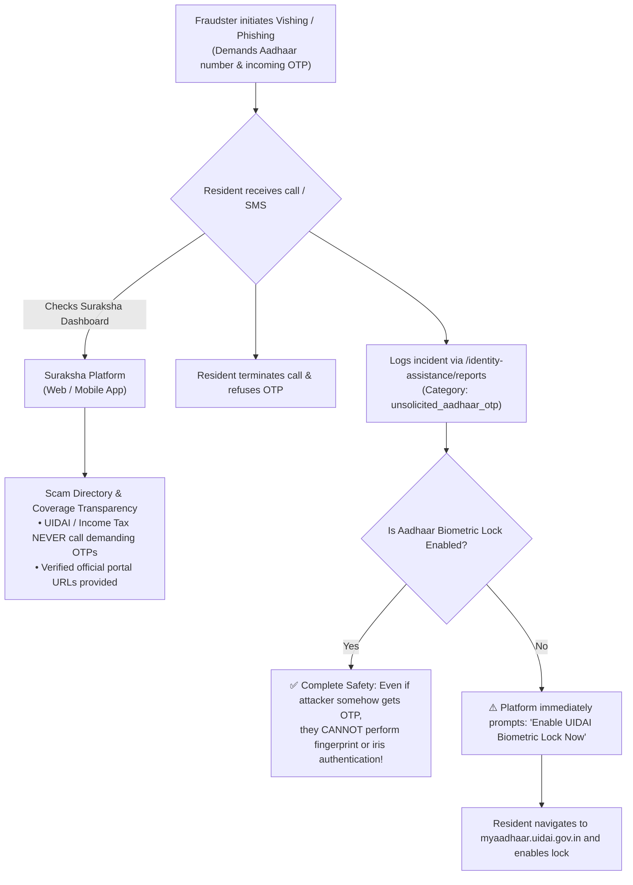

# Case 07: Phishing & Vishing / Fraudulent KYC Traps

**Identifier:** `CASE-07`  
**Threat Category:** Social Engineering, Voice Phishing (Vishing) & SMS Phishing (Smishing)  
**Associated Views:** Coverage Transparency & Aadhaar/PAN Assistance  
**Associated Guidelines:** UIDAI Public Advisories & CERT-In Smishing Warnings

---

## 1. Problem Statement

Vishing (voice phishing) and Smishing (SMS phishing) are the most common vectors for Aadhaar fraud in India:

### Common Attack Patterns:
1. **The "Bank KYC Suspension" Threat:**
   - Resident receives an SMS: *"Dear customer, your SBI / HDFC account will be blocked within 24 hours due to incomplete PAN-Aadhaar linkage. Click here: `http://sbi-kyc-update.xyz/login`"*.
2. **The "Electricity Disconnection" Scam:**
   - Fraudster calls claiming electricity will be cut off tonight unless a small payment or Aadhaar verification is completed via an APK file sent on WhatsApp.
3. **The "Courier / Parcel" Trap:**
   - Fraudster claims a parcel from FedEx contains illegal items and demands the resident's Aadhaar number and OTP to "clear their name with the Mumbai Police".

---

## 2. End-to-End Architectural Flow & Defense-in-Depth

---

## 3. The Power of UIDAI Biometric Locking

A critical architectural value of Suraksha's guidance layer is educating residents that **UIDAI Biometric Lock is the ultimate cryptographic countermeasure against identity impersonation**:
- Even if a scammer acquires a resident's Aadhaar number, PAN card photocopy, and home address, **they cannot authenticate without biometric verification at banks, telecom stores, or registrar offices**.
- When Biometric Lock is enabled, UIDAI's central servers automatically return `Error 330: Biometrics are locked by resident`.
- The resident can unlock their biometrics temporarily for 10 minutes when they personally visit a bank, after which it automatically re-locks.
