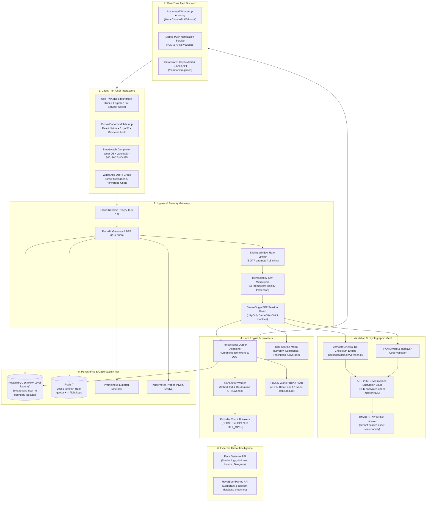

# Master End-to-End Dataflows: User ➔ Backend ➔ User

This document specifies the complete end-to-end technical dataflow and state machine transitions across all micro-modular subsystems of the Suraksha platform.

---

## 1. Complete System Architecture Dataflow



---

## 2. State Machine: Identity & Incident Lifecycle

### A. Identifier Verification Lifecycle (`FR-007`)
```
[Unverified / Draft]
         │
         ▼  (User requests verification)
[Verification Pending]  ──(5 attempts exceeded)──>  [Verification Locked]
         │
         ▼  (Correct 6-digit challenge token submitted)
[Verified & Active]
         │
         ├─────────────────────────────────────────┐
         ▼ (User pauses monitoring)                 ▼ (Consent withdrawn)
   [Monitoring Paused]                     [Withdrawn & Purged]
```

### B. Incident Severity & Resolution Lifecycle (`FR-014`, `FR-016`)
```
[External Observation Ingested]
         │
         ▼  (Deduplication against grouping_key)
    [New Incident]  ──(Priority 80-100: Critical / High)
         │
         ├─────────────────────────────────────────┐
         ▼ (User views & acknowledges)              ▼ (User disputes match)
  [In Progress]                             [Dispute Under Review]
         │                                         │
         ▼ (All remediation tasks checked)         ▼ (Verified false-positive)
   [Remediated]                               [Dismissed]
```

---

## 3. Storage Invariants & Security Matrix

| Data Element | In-Flight Protection | At-Rest Protection | Display Rules | Retention Policy |
| :--- | :--- | :--- | :--- | :--- |
| **12-Digit Aadhaar** | TLS 1.3 / In-Memory only | **AES-256-GCM Envelope** + HMAC Blind Index | **Masked Only** (`XXXX-XXXX-1234`) | Erased upon account deletion or consent revocation |
| **10-Character PAN** | TLS 1.3 / In-Memory only | **AES-256-GCM Envelope** + HMAC Blind Index | **Masked Only** (`AB***12*F`) | Erased upon account deletion or consent revocation |
| **Plaintext Passwords** | **Never stored** | **Discarded immediately** | `credential_material_present=True` | Never written to database |
| **Session Cookies / Tokens** | HttpOnly SameSite=Strict | Server-side Redis session store | Never exposed to client JS | 24-hour rolling expiry |
| **Audit Logs** | Immutable Append-Only | PostgreSQL write-only table | Operator metadata view only | 180-day retention per CERT-In directive |
