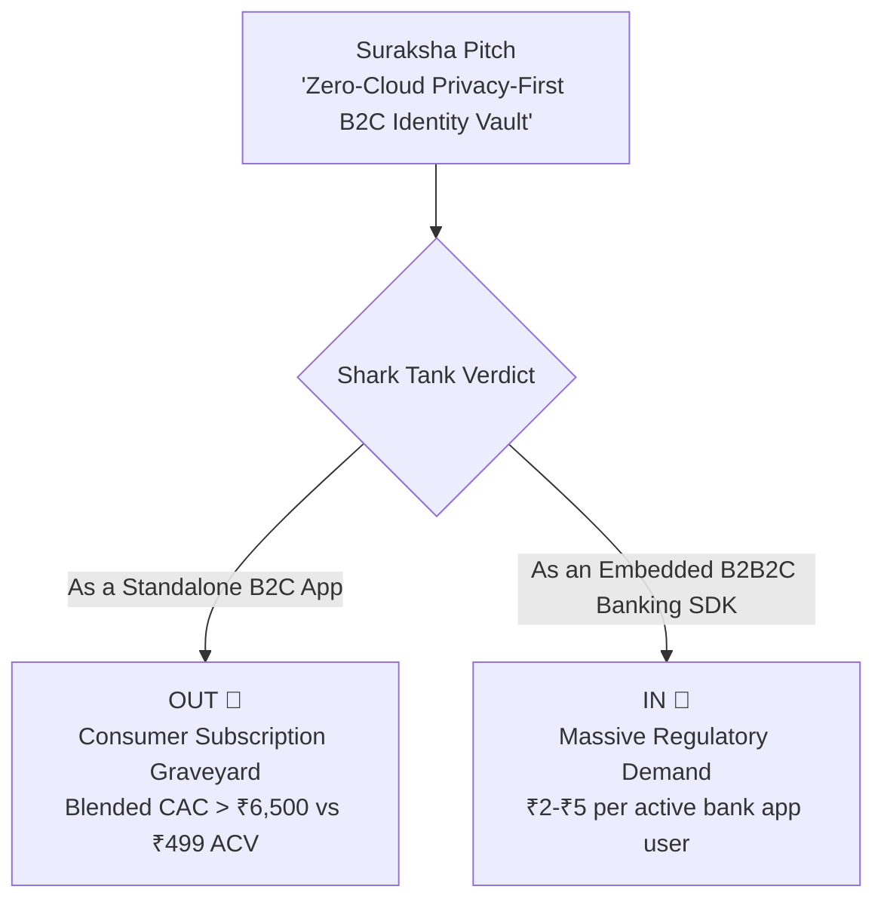
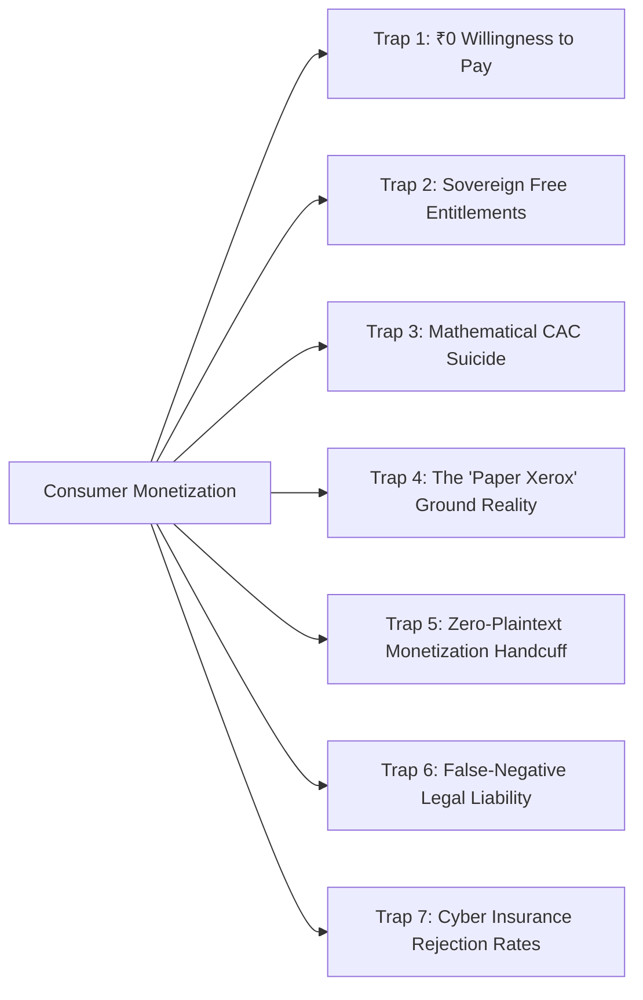
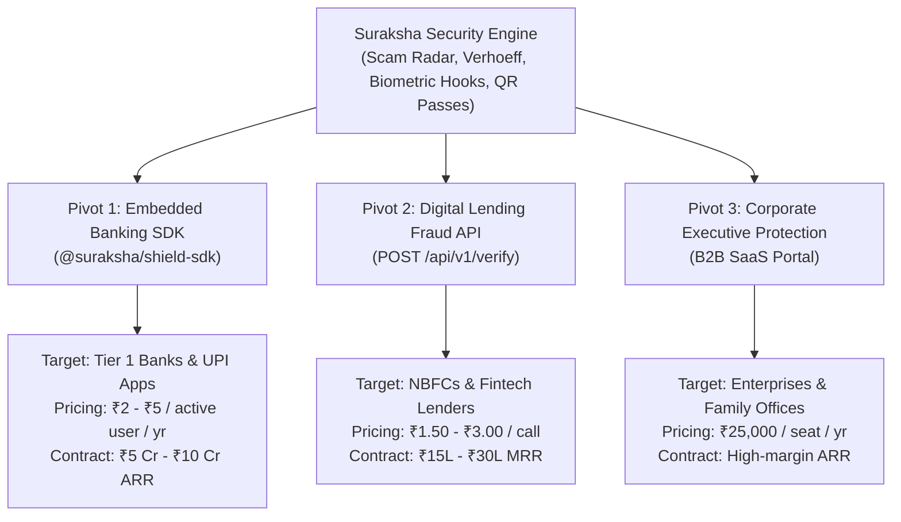

# Shark Tank Strategic Teardown & Monetization Analysis

**Project:** Suraksha Identity Protection Platform (`aadhar-tracker`)  
**Auditor:** Venture Capitalist & Shark Tank Commercial Review Panel  
**Date:** 16 November 2026  
**Document Status:** Strategic Commercial Assessment & Pivot Roadmap  

---

## 1. Executive Summary: The Shark Tank Opening

> **The Pitch:**  
> *"Sharks, identity theft in India is at a historic boiling point! Digital arrests, Aadhaar photocopying at hotels, and malicious APK sideload scams are ruining families. We built Suraksha—a privacy-first, zero-cloud identity protection platform with Verhoeff verification, time-bombed hotel passes, and scam radar!"*
> 
> **The Panel Verdict:**  
> *"You built an app that tells citizens to do what the government's free mAadhaar app already does, warns them about scams that Truecaller already flags, generates hotel check-in QR codes that front-desk staff will reject in favor of paper Xerox copies, and you expect price-sensitive Indian consumers to pay you ₹499/year? **Yeh dhandha nahi hai, yeh open-source public service hai. And for that reason, I am OUT as a B2C business.**"*

---

## 2. The 7 Fatal B2C Monetization Traps

### Trap 1: The "Indian B2C Subscription Graveyard"
India is notoriously the most difficult consumer software subscription market in the world. Outside of three narrow categories, consumer willingness-to-pay for standalone mobile software hovers near absolute zero:
1. **Direct Speculative / Financial Return:** Stock trading (Zerodha), Mutual funds (Groww), Crypto platforms.
2. **Pure Escapist Entertainment:** OTT streaming (Netflix, Disney+ Hotstar for IPL, YouTube Premium).
3. **Status / Matrimonial:** Dating apps (Tinder, Bumble), Matrimony platforms (Shaadi.com).

Even **Truecaller**—installed on over 250 million Indian smartphones, providing immediate daily relief from spam calls—converts less than **1.8% of its active Indian base** to paid subscriptions. Asking an average resident to pay ₹49/month or ₹499/year for **preventive peace of mind against invisible threats** violates the fundamental psychographics of the Indian retail consumer.

---

### Trap 2: The "Sovereign Extinction Event" (DPI Free Alternatives)
The core utility features of Suraksha directly overlap with free Digital Public Infrastructure (DPI) maintained by the Government of India and statutory bodies:

| Suraksha Feature | Government / Free Sovereign Alternative | Cost to Resident |
| :--- | :--- | :--- |
| **Biometric Lock / Unlock** | Official UIDAI **mAadhaar** Mobile App & Portal | **FREE** |
| **Ghost SIM Card Detection** | Department of Telecom (DoT) **TAFCOP** Portal | **FREE** |
| **Stolen Handset / IMEI Barring** | Central Equipment Identity Register (**CEIR / Sanchar Saathi**) | **FREE** |
| **Tamper-Proof ID Storage** | Ministry of Electronics & IT (**DigiLocker**) | **FREE** |
| **Cybercrime Complaint Generation** | National Cyber Crime Reporting Portal (**1930 / cybercrime.gov.in**) | **FREE** |

**The Sovereign Risk:** If UIDAI, NPCI, or MeitY releases an update to mAadhaar or DigiLocker introducing automated biometric relock timers or watermarking, **the consumer value proposition of Suraksha evaporates overnight.**

---

### Trap 3: The CAC vs. LTV Mathematical Bloodbath
A realistic unit economics model for acquiring paid B2C subscribers in India via paid acquisition channels (Meta, Google, YouTube Ads):

| Metric | Optimistic Case | Realistic Indian Industry Benchmark |
| :--- | :--- | :--- |
| **Cost Per Install (CPI)** | ₹35 | ₹65 – ₹110 |
| **Install-to-Active Retention (D30)** | 40% | 22% – 25% |
| **Active-to-Paid Subscription Conversion** | 3.0% | **0.6% – 1.0%** |
| **Blended Customer Acquisition Cost (CAC)** | ₹2,900 | **₹6,500 – ₹11,000 per paying subscriber** |
| **Annual Price Point (ACV)** | ₹999 / year | ₹399 – ₹499 / year |
| **Net Gross Margin (after app store 15% cut + infra)** | 70% | 60% (~₹240 net / year) |
| **Payback Period** | 4.1 years | **27+ Years (Commercial Insolvency)** |
| **Annual Subscription Churn** | 45% | **65% – 75%** |

Because "nothing bad happens" to 98% of users each year, subscribers view security subscriptions as an unnecessary recurring tax and churn after Year 1. With an 8-month customer lifetime and an ₹8,000 CAC, the business burns cash uncontrollably.

---

### Trap 4: The "Paper Xerox" Ground Reality Disconnect
Suraksha includes a **Zero-Install Public Pass Verifier** and **Time-Bombed Hotel Ephemeral Passes**.

* **The Architectural Vision:** Hotels scan an offline Ed25519 QR pass, verify guests in 3 seconds, and eliminate physical identity paper trails.
* **The Ground Reality:** 
  - In 95% of budget, 3-star, and 4-star hotels across India, reception desks are bound by local police station mandates.
  - Beat constables conduct weekly physical inspections of hotel guest binders. If an inspector does not find a physical paper photocopy of an Aadhaar/Passport stapled to the guest registration card, the hotelier faces immediate administrative harassment or fines.
  - The front-desk receptionist will tell the traveler: *"Sir, aapka digital QR code theek hai, but hume paper Xerox register me lagana padega."*
  - The hotel has **zero incentive** to purchase or integrate a digital verifier software when paper copies transfer all legal friction onto the guest.

---

### Trap 5: The "Zero-Plaintext" Monetization Handcuff
* **The Paradox:** Suraksha was built with impeccable cryptographic principles:
  - Strict **Zero-Plaintext Invariant** (no raw 12-digit Aadhaar, no biometric persistence).
  - Multi-tenant isolated blind indexing.
  - Full DPDP Act 2023 compliance.
* **The Commercial Consequence:** You deliberately closed off the only business model that actually subsidizes "free" consumer fintech in India: **Data Harvesting & Cross-Selling Financial Products.**
  - Competitors offer free utilities to build deep financial graphs, which they monetize by selling high-margin pre-approved personal loans (18-36% APR), credit cards, and term insurance policies.
  - Because Suraksha cannot see, mine, or store the user's unmasked profile, it cannot broker lucrative financial lead-generation deals with NBFCs or banks.

---

### Trap 6: The "False Negative" Legal & Reputational Nightmare
* Suraksha’s `ScamRadarEngine` uses compiled regex heuristics to flag Digital Arrests and malicious APK sideload links.
* **The Threat:** Attack syndicates mutate their scripts daily, moving from *"CBI Skype interrogation"* to regional police dials, fake judicial summons, or WhatsApp voice notes.
* **The Liability:** When a senior citizen checks a fraudulent message on Suraksha, receives a `"Threat Level: Safe (No matched indicators)"` verdict due to an unrecognized pattern, and subsequently transfers ₹50 Lakh of retirement savings to a mule account:
  - Suraksha will be publicly blamed on social media and named in consumer court complaints for providing a false sense of security.
  - A small software startup cannot absorb the legal fees or reputational fallout of catastrophic extortion events.

---

### Trap 7: Cyber Insurance Rejection Rates
* **The Theory:** Bundle identity monitoring with a ₹1 Lakh cyber fraud insurance policy via an underwriting partner.
* **The Reality in India:**
  - Retail cyber insurance in India is heavily restricted with exclusions (e.g., voluntary OTP sharing, unverified APK installation, negligence).
  - Claim rejection rates on individual retail cyber policies in India exceed **80%**.
  - Annual premiums for retail coverage are negligible (₹150 – ₹300/year), offering tiny commission margins (₹30 – ₹50) that cannot support user acquisition.

---

## 3. Shark Commentary & Persona Feedback

### Ashneer Grover
> *"Bhai kya kar raha hai yaar tu? 81 automated tests likh diye, Verhoeff algorithm laga diya, Ed25519 signatures bana diye... Par dhandha kahan hai? Yeh project tera engineering college ka final year project lag raha hai jisme professor ne 10 out of 10 de diye, par market me aate hi zero revenue generate karega. B2C subscription India me dead hai. Dhandha band kar, kisi bank ko jaake code bech aur naukri dhoondh."*

### Anupam Mittal
> *"See, the problem you are solving is very real. Digital arrest is an epidemic destroying families. But you are confusing a **Feature** with a **Product**, and a **Product** with a **Business**. You have built a feature set that belongs inside HDFC Bank's mobile app, PhonePe, or Truecaller. Standing alone as a consumer app, your customer acquisition cost will eat you alive. How will you reach 65-year-old retired uncles? On Instagram? Your marketing funnel is broken."*

### Peyush Bansal
> *"I respect the craftsmanship—the offline verifier, the zero-plaintext invariant, the respect for citizen dignity. But consumer software in India cannot survive on subscription alone. Unless you figure out who has the deepest pockets to pay for this on behalf of the user, this will remain a non-profit open-source repository."*

---

## 4. The Strategic Pivot Playbook: Where the Money Actually Is

To transform Suraksha from an unprofitable consumer utility into a high-margin, scalable enterprise business, the company must execute an immediate **B2B / B2B2C pivot**:

### Pivot 1: Embedded Mobile Banking SDK (`@suraksha/shield-sdk`)
* **Target Buyers:** HDFC Bank, ICICI Bank, State Bank of India, PhonePe, Paytm, CRED.
* **Pain Point:** The Reserve Bank of India (RBI) mandates aggressive digital fraud controls. Mule bank accounts, SIM-swap attacks, and unauthorized AePS biometric withdrawals cost Indian banks hundreds of crores in ombudsman complaints, litigation, and brand erosion.
* **The Product:** Package `ScamRadarEngine`, `Verhoeff` validator, and biometric relock countdown hooks into an embedded iOS/Android SDK.
* **Pricing & Economics:**
  - Charge **₹2 to ₹5 per active mobile banking user per year**.
  - A single tier-1 bank with 25 million mobile app users represents a **₹5 Crore to ₹12.5 Crore annual recurring revenue (ARR)** contract with zero consumer ad spend.

### Pivot 2: Real-Time Fraud Verification API for Digital Lenders (NBFCs)
* **Target Buyers:** Instant loan apps, NBFCs, credit aggregators (KreditBee, MoneyTap, Navi, Bajaj Finserv).
* **Pain Point:** Synthetic identity fraud (pairing real PANs with fabricated Aadhaar details or forged hotel check-in scans) represents the single highest driver of Non-Performing Assets (NPAs) in unsecured digital lending.
* **The Product:** Provide low-latency REST endpoints for mathematical Verhoeff validation, OCR document tampering detection, and dark-web breach canary checking before loan disbursement.
* **Pricing & Economics:**
  - Charge **₹1.50 to ₹3.00 per verification API call**.
  - At 1.5 million loan originations per month across 3 mid-tier NBFCs, that yields **₹22.5 Lakh to ₹45 Lakh MRR** (~₹3 to ₹5 Crore ARR) in pure software margin.

### Pivot 3: Corporate Executive & Family Office Protection Suite
* **Target Buyers:** Tata Group, Reliance Industries, Infosys, top-tier legal firms, and Family Offices.
* **Pain Point:** C-suite executives, board members, and high-net-worth promoters are prime targets for deepfake extortion, SIM-swap account takeovers, and corporate spear-phishing.
* **The Product:** "Suraksha Executive Suite"—a centralized CISO portal monitoring executive credential leakage, leaked family Aadhaar documents, and providing white-glove 1930 incident response.
* **Pricing & Economics:**
  - Charge **₹25,000 to ₹1,00,000 per executive seat per year**.
  - Protecting 100 enterprise executives yields an effortless **₹25 Lakh to ₹1 Crore ARR** with 95%+ gross margins.

---

## 5. Commercial Scorecard & Final Recommendation

| Dimension | Consumer B2C Score | Enterprise B2B2C Score | Strategic Assessment |
| :--- | :---: | :---: | :--- |
| **Technical Architecture** | 9.5 / 10 | 9.5 / 10 | Cryptographically sound, Zero-Plaintext, 81/81 test pass rate. |
| **Willingness to Pay** | 1.0 / 10 | 8.5 / 10 | Consumers refuse to pay; enterprise banks have dedicated compliance budgets. |
| **Customer Acquisition Cost** | 1.5 / 10 | 8.0 / 10 | B2C CAC is fatal; enterprise direct sales yields 8-figure contract values. |
| **Regulatory Tailwinds** | 4.0 / 10 | 9.0 / 10 | RBI digital payment fraud circulars force banks to buy fraud-shield software. |
| **Overall Commercial Viability** | **2.0 / 10 (FAIL)** | **8.8 / 10 (SCALE)** | **Kill standalone B2C subscriptions; pivot 100% to Enterprise SDK & API.** |
